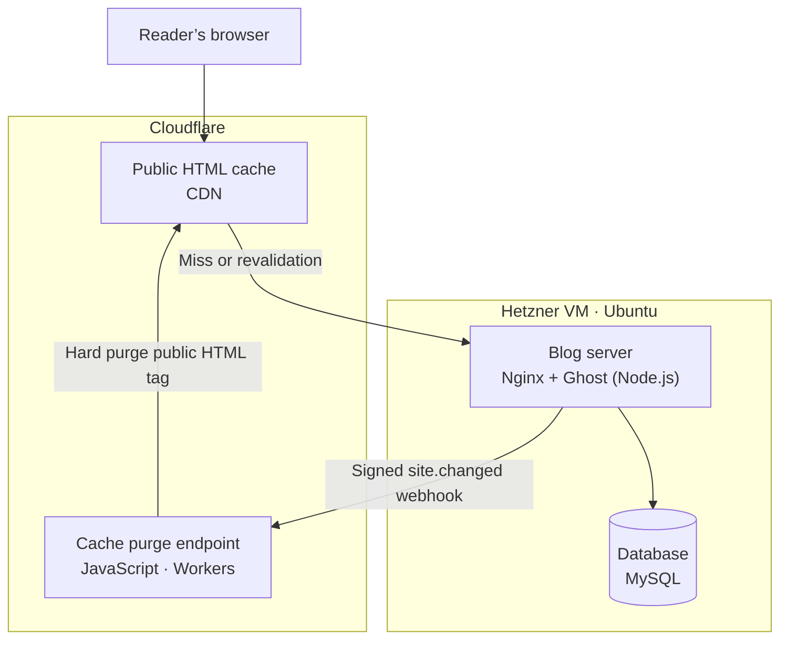

# Ghost hosting

[Repository overview and theme workflow](../README.md)

Production runs Ghost on a permanent Hetzner CX23: Ubuntu 24.04,
Node 22, MySQL 8, Ghost 6.72.0, Nginx, UFW, and 2 GiB swap. Ghost runs as an
unprivileged account on loopback. Installation paths are fixed for this site.

Terraform owns the server and primary IPs, with deletion guards. It reuses an
existing SSH public key. Paid daily backups are controlled by `backups`;
preserve the observed setting when adopting a server. Cloudflare DNS and origin
certificate issuance/renewal remain manual. Git pushes and CI never deploy.

## Request serving



Ownership: [origin configuration](ansible/), [Cloudflare rules and purge endpoint](cloudflare/).
The cache policy and activation steps are in [Public page caching](#public-page-caching).

## Quick start

Use the [root Pixi setup](../../README.md#local-installation). From the monorepo root:

```sh
pixi run --locked setup
pixi run --locked hosting-test
```

Setup installs pinned Ansible collections in ignored `data/ansible/collections`.
The test task validates configuration without connecting to a server.
Python and tool versions live in the root manifest and `pixi.lock`; provider versions
remain in `terraform/.terraform.lock.hcl`. The Makefile implements the hosting tasks.

## Private inputs

Choose an absolute directory **outside Git**, with mode `0700` and private files
mode `0600`. Copy the three examples there once and fill them in:

```sh
export DEPLOY_PRIVATE=/absolute/private/ghost
umask 077
mkdir -p "$DEPLOY_PRIVATE"
cp 121gigawatts/hosting/terraform/site.tfvars.example "$DEPLOY_PRIVATE/site.tfvars"
cp 121gigawatts/hosting/ansible/inventory.example.yml "$DEPLOY_PRIVATE/inventory.yml"
cp 121gigawatts/hosting/ansible/site.example.yml "$DEPLOY_PRIVATE/site.yml"
```

Do not overwrite existing inputs when returning to this workflow. Keep real
inventories, credentials, private keys, backups, state, saved plans, and logs
outside the repository. See [hosting review guidelines](AGENTS.md).

Supply a project-scoped `HCLOUD_TOKEN` through the environment. Verify the SSH
host fingerprint before recording it in `known_hosts`. Supply a separate private
Ghost `config.production.json` with MySQL database `ghost_prod`, user `ghostapp`,
and a strong password. Keep that password stable between runs; rotation is
separate. Ghost binds `127.0.0.1:2368`, MySQL uses `127.0.0.1`, and content lives
at `/var/www/121gigawatts/content`. Set the same URL in Ghost config and `site.yml`.
Use the public HTTPS origin for production and working SMTP for login emails.
Use `http://localhost:2371` only for an isolated restore preview.

Supply `origin_certificate_file` and `origin_key_file`, or install both directly
under `/etc/ssl/121gigawatts` and omit those inputs. Cloudflare Origin CA requires
proxied traffic with Full (strict) TLS. Browsers do not trust it directly.
Renew certificates before expiry.

## Infrastructure

Initialize Terraform, keeping its working data outside Git:

```sh
export TF_DATA_DIR="$DEPLOY_PRIVATE/terraform-data"
pixi run --locked terraform -chdir=121gigawatts/hosting/terraform init -lockfile=readonly
```

For an existing server, import its three resources once. Obtain their IDs from
Hetzner; verify they belong to the intended CX23. Skip these commands only when
intentionally creating a new paid server.

```sh
pixi run --locked terraform -chdir=121gigawatts/hosting/terraform import -state="$DEPLOY_PRIVATE/terraform.tfstate" -var-file="$DEPLOY_PRIVATE/site.tfvars" 'hcloud_primary_ip.site["ipv4"]' "$IPV4_ID"
pixi run --locked terraform -chdir=121gigawatts/hosting/terraform import -state="$DEPLOY_PRIVATE/terraform.tfstate" -var-file="$DEPLOY_PRIVATE/site.tfvars" 'hcloud_primary_ip.site["ipv6"]' "$IPV6_ID"
pixi run --locked terraform -chdir=121gigawatts/hosting/terraform import -state="$DEPLOY_PRIVATE/terraform.tfstate" -var-file="$DEPLOY_PRIVATE/site.tfvars" hcloud_server.site "$SERVER_ID"
```

Plan, inspect the proposed changes, then explicitly apply the saved plan:

```sh
pixi run --locked terraform -chdir=121gigawatts/hosting/terraform plan -state="$DEPLOY_PRIVATE/terraform.tfstate" -var-file="$DEPLOY_PRIVATE/site.tfvars" -out="$DEPLOY_PRIVATE/review.tfplan"
pixi run --locked terraform -chdir=121gigawatts/hosting/terraform apply -state="$DEPLOY_PRIVATE/terraform.tfstate" "$DEPLOY_PRIVATE/review.tfplan"
```

Review creation, resize, backup charges, and deletion proposals. Adoption can
record provider defaults and public-network IDs as an in-place change; verify
them against Hetzner. Creation-time SSH keys cannot be reconciled after import;
manage subsequent key changes on the server. Back up the private state.

## Configure

For a fresh restore target, install with Ghost held stopped so its database stays
empty:

```sh
pixi run --locked hosting-configure HOLD=1
```

Omit `HOLD=1` only to start a new empty site. On an already configured server,
predict changes before applying them:

```sh
pixi run --locked hosting-check
pixi run --locked hosting-configure
```

`configure` can restart services. Ansible check mode needs existing packages and
files; it is not a first-installation test.

Files can stay publicly accessible while being excluded from search results.
Add exact URI entries to server-local `/etc/nginx/noindex-paths.conf`, for example
`"/path/to/file.pdf" "noindex";`, then run `nginx -t` and reload Nginx.
Ansible creates this include file when absent and preserves its existing entries.
The template emits `X-Robots-Tag` alongside the cache headers. These entries control
indexing, not access, and their contents stay outside Git.

The playbook installs or reconciles the pinned Ghost version; it refuses an
implicit version upgrade. Node 22 patch updates follow the package repository.
OS upgrades and Ghost upgrades are separate maintenance operations. MySQL uses
Ubuntu defaults. Removing an existing `99-ghost-small.cnf` override restarts
MySQL; inspect that change before applying to a running site.

Ghost stops when MySQL stops and starts after MySQL returns, including a separate
stop/start during package updates. Its unit is enabled for both system boot and
MySQL startup; the playbook installs the MySQL startup link when missing,
including on existing installations. `Restart=on-failure` handles Ghost process
failures. Automatic security updates remain enabled.

To check this dependency behavior without touching the live services, run on a
Linux host with systemd:

```sh
sudo python3 121gigawatts/hosting/tests/check_systemd_recovery.py
```

The check uses temporary services and removes them afterward. It exercises an
existing installation's startup-link update, database stop/start, restart, and
an intentional Ghost stop.

## Restore

Use a matched SQL dump and content archive from the same validated Ghost 6
snapshot. Set their paths in the private variables:

- SQL: gzip-compressed full `mysqldump`; use a private MySQL option file for credentials.
- Content: gzip tar of directories inside `content/`, including uploads, settings
  and the active theme. Exclude config and `node_modules`; links and escaping paths
  are rejected.

Test recovery on an isolated target first. Confirm the owner account, post/draft
counts and uploads. Backups must be compatible with the pinned Ghost version;
version upgrades are a separate operation.

On an empty target database only:

```sh
pixi run --locked hosting-restore CONFIRM="RESTORE blog.example.org"
```

Replace the confirmation domain with `domain` in the private variables. The
restore validates the backups once and checks the database is empty before stopping Ghost.
It then imports SQL, replaces content while retaining the old directory, clears
browser sessions, and starts Ghost. A preflight refusal leaves the service alone;
a failure after import starts leaves Ghost stopped. It never clears a nonempty
database for you.
Back up the target and explicitly prepare an empty database before retrying a
partial import. Keep previous content and SQL backups until validation passes.

## Site verification

Check the public site with `pixi run --locked python 121gigawatts/hosting/verify.py https://121gigawatts.org`.
For an isolated restore preview, forward the loopback service:

```sh
ssh -N -L 127.0.0.1:2371:127.0.0.1:2368 root@"$SERVER_IPV4"
# In another terminal:
pixi run --locked python 121gigawatts/hosting/verify.py http://localhost:2371
```

Open the site and `/ghost/`. Verify owner login, email delivery,
post/draft counts, theme, navigation, GIFs, Google Slides, and the Copper Sushi
map. The script checks sitemap pages and same-origin HTML assets; browser
review is still needed for external embeds, CSS images, and interactions.
Disable analytics and use a test SMTP destination on an isolated restore target.

Check HTTPS without DNS changes using the Cloudflare Origin CA trust bundle
obtained from Cloudflare's official documentation:

```sh
curl --fail --cacert "$DEPLOY_PRIVATE/origin-ca.pem" \
  --resolve "$DOMAIN:443:$SERVER_IPV4" "https://$DOMAIN/"
```

Keep certificate verification enabled. Verify canonical links and redirects use
the configured public HTTPS origin on production.

## Public page caching

Anonymous public HTML uses `Cloudflare-CDN-Cache-Control: public, max-age=300,
stale-if-error=86400`. Browser `Cache-Control` is preserved. Nginx tags successful
public HTML as `ghost-public-html`; session cookies, authorization, previews,
query variants, APIs, private responses and session-setting responses are excluded.
Any cookie bypasses HTML caching, including analytics cookies. Normal static
asset policy remains intact. Error responses never receive the public policy.

A signed Ghost `site.changed` webhook calls [the purge Worker](cloudflare/worker.mjs),
which hard-purges that tag after public content, theme or settings changes.
Images and unrelated hosts are not tagged or purged. This event covers the whole
public site; there is no per-post dependency graph or queue.

Purge delivery is best effort. Ghost 6.72 does not retry failed POST webhooks.
A missed purge leaves old pages until normal expiry; with the origin down, the
last good copy may remain for the stale window, including unpublished content.
Hard purge, eviction and cold cache locations can leave no outage copy.

### Cloudflare access

Run these commands from the **monorepo root**, the directory containing
`pyproject.toml`, not the nested `121gigawatts/` theme directory. Wrangler runs
through `npx`; no global installation is needed. The pinned version and `--yes`
avoid an unexpected npm installation prompt. Check the saved login first:

```sh
pixi run --locked npx --yes wrangler@4.158.0 whoami
```

If login is missing, expired or belongs to the wrong account, offer browser
login to the account that owns the site's zone:

```sh
pixi run --locked npx --yes wrangler@4.158.0 login
```

Wrangler login is account-wide and does not require a particular directory.
The monorepo root keeps our Pixi environment and relative deployment paths
unambiguous. From another directory, select the checkout explicitly:

```sh
pixi run --manifest-path /absolute/path/to/coppersushi/pyproject.toml --locked npx --yes wrangler@4.158.0 login
```

Check available OAuth permissions before requesting a token:

```sh
pixi run --locked npx --yes wrangler@4.158.0 login --scopes-list
```

Wrangler login supports Worker deployment. Request a scoped API token only for
permissions OAuth does not provide or credentials the deployed service needs;
this cache setup needs cache-rule management and a runtime token with Cache Purge.
A denied operation does not by itself mean browser login is unusable. Keep
account details and command output containing private identifiers outside Git.
See [Wrangler's authentication commands](https://developers.cloudflare.com/workers/wrangler/commands/general/).

### Activation

Deployment requires explicit approval. Keep existing Cloudflare rules, settings
and private Worker variables outside Git. Deploy in this order:

1. Configure the Nginx templates with the existing Ansible workflow. Check the
   private-input diff before applying; `nginx -t` precedes reload.
2. Follow [Cloudflare access](#cloudflare-access) to authorize the site's zone. The runtime token needs
   **Cache Purge** permission for that zone. A dedicated token limits its scope;
   reusing the deployment token also grants the Worker its broader permissions. Set Worker secrets
   `GHOST_WEBHOOK_SECRET` (at least 32 random characters) and
   `CLOUDFLARE_PURGE_TOKEN`; set `CLOUDFLARE_ZONE_ID` as a private variable.
   Use Wrangler with [cloudflare/wrangler.jsonc](cloudflare/wrangler.jsonc).
   The only routed path is `/.well-known/ghost-cache-purge`; workers.dev and
   preview URLs are disabled. Account IDs and credentials stay outside Git.

   ```sh
   pixi run --locked npx --yes wrangler@4.158.0 deploy --config 121gigawatts/hosting/cloudflare/wrangler.jsonc --var "CLOUDFLARE_ZONE_ID:$CLOUDFLARE_ZONE_ID"
   pixi run --locked npx --yes wrangler@4.158.0 secret put GHOST_WEBHOOK_SECRET --config 121gigawatts/hosting/cloudflare/wrangler.jsonc
   pixi run --locked npx --yes wrangler@4.158.0 secret put CLOUDFLARE_PURGE_TOKEN --config 121gigawatts/hosting/cloudflare/wrangler.jsonc
   ```
3. Create a Ghost custom integration webhook for **Site changed (rebuild)**,
   targeting `https://121gigawatts.org/.well-known/ghost-cache-purge`. Set its
   `secret` through `POST /ghost/api/admin/webhooks/` or
   `PUT /ghost/api/admin/webhooks/{id}/` to the same Worker secret. Keep the
   request/response privately: they contain the secret. The Worker rejects
   unsigned calls. Use Ghost's [Admin API authentication](https://docs.ghost.org/admin-api/authentication).
4. Install the two [cache rules](cloudflare/cache-rules.json) in their listed
   order after existing rules; keep their stable `ref` values when updating.
   Merge them into the existing `http_request_cache_settings` ruleset, never
   replace unrelated rules. Inspect Page Rules and Cache Response Rules too:
   no broader setting may override this origin policy or strip session cookies.
   Keep Edge and Browser TTL in **respect origin** mode and turn off Always
   Online, which ignores these stale directives. Confirm cache-tag support for
   the zone before enabling HTML caching.
5. Verify the behavior below before treating the rollout as complete.

### Verification and failure evidence

After publishing or editing, inspect the integration's webhook delivery record:
`last_triggered_at` must be newer than the edit, with no `last_triggered_error`.
A previous success is not proof that the latest edit delivered. Ghost also logs
`WEBHOOK_DELIVERY_FAILURE`; the Worker logs `ghost_public_html_purge_failed`
and returns 503 when the purge fails or times out. It returns 200 only after
Cloudflare confirms success. Cloudflare Worker observability is enabled, but
logs do not create alerts. Logging retention is controlled by the account plan.

Request the changed page anonymously twice and confirm the edited content and a
cache HIT. Check the header with `curl -sS -D - -o /dev/null URL`, without cookies
or query strings. Admin and a preview must stay uncached; login cookies must be
preserved. Verify images and versioned CSS/JS still load without Ghost.

On an isolated origin, warm a page, let its five-minute lifetime expire, then
return 502. Verify the prior page is served, restore the origin, and verify it
updates. A fresh HIT does not prove stale-on-error behavior. Do not stop the
production origin just to run this check. Include post publication, changed
slug, unpublishing, theme/settings edits, rejected signatures and a failed purge
in rollout verification. On failure, disable the HTML eligibility rule, purge
`ghost-public-html`, and investigate the two delivery logs before re-enabling.

`hosting-test` runs signed-webhook and purge-response tests. Nginx is required
for the cache-header integration tests; CI installs it, while local hosts without
Nginx skip only those integration tests.

Provider behavior: [Cloudflare cache control](https://developers.cloudflare.com/cache/concepts/cache-control/),
[cache tags](https://developers.cloudflare.com/cache/how-to/purge-cache/purge-by-tags/),
[Ghost site-change event](https://github.com/TryGhost/Ghost/blob/v6.72.0/ghost/core/server/web/parent/middleware/emit-events.js).
