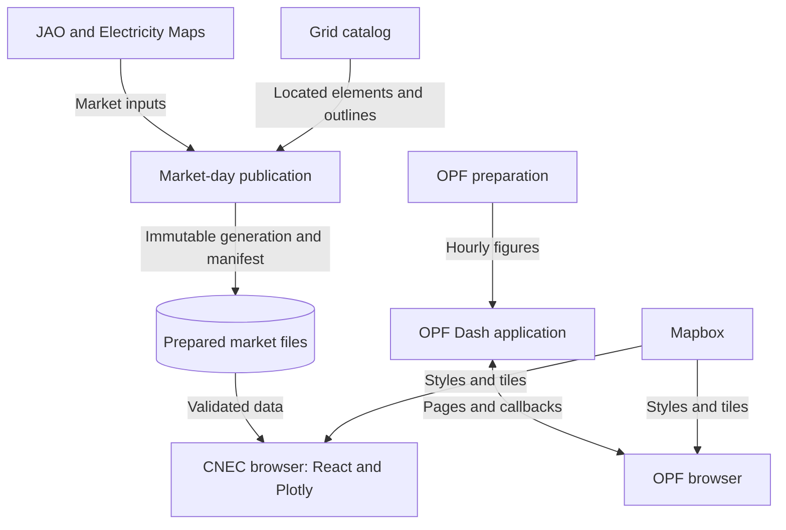

# Copper Sushi 🍣
## Electricity tools and 1.21 Gigawatts
[](https://121gigawatts.org/copper-sushi-power-flow-european-grid/)

This monorepo owns the power-flow and grid-constraint apps, price forecasting,
and the [1.21 Gigawatts Ghost theme and hosting](121gigawatts/README.md).
The power-flow app visualises optimisation solutions from
[`pypsa-eur`](https://github.com/PyPSA/pypsa-eur).

The web app is deployed
[**here**](https://121gigawatts.org/copper-sushi-power-flow-european-grid/),
along with an explanation of the main features.

The app has two views: `/opf-2024` (29 August 2024, hourly, on the 2025 grid)
and `/cnec` (prices and binding constraints). The CNEC view officially supports
delivery dates from **1 November 2026** onward; earlier dates are outside supported
coverage. The supported-history sweep is pending; not every supported date has been verified. This cutoff does not apply to the separate OPF demonstration. `/embed/opf-2024` shows the OPF map
and time controls without navigation. Both OPF layouts use the same solved network.

For the first rollout, `/` also shows the embed, preserving the article's existing
iframe. `ROOT_VIEW=embed` is the default; set `ROOT_VIEW=full` only after the article
uses `/embed/opf-2024`. Model details: [power-flow architecture](wiki/sushi-2.md).

Networks are versioned with [Git LFS](https://git-lfs.com). Install `git-lfs` system-wide (`brew install git-lfs`)
so git works from any shell or IDE, run `git lfs install` once to register the filters that turn pointers into
files, then `git lfs pull`. The Pixi environment also includes `git-lfs` for commands run through `pixi run`.
Clone with `GIT_LFS_SKIP_SMUDGE=1` to skip the files, e.g. to run only the tests.

## System design



Components: [CNEC browser](frontend/README.md), [publication](coppersushi/publication/README.md),
[grid catalog](coppersushi/grid_catalog/README.md), [OPF](coppersushi/opf/README.md).
Prepared CNEC data is independent of request-time Python calculations. The local
Flask shell serves the browser and its prepared files; OPF retains Dash.

## Working with Agents
The repository is developed with coding agents (Claude Code and Codex), and the tooling for that is
part of the repository:

- [`AGENTS.md`](AGENTS.md) holds the rules the agents follow here. Every directory with rules of its own
  has one.
- [`.agents/skills/`](.agents/skills/) holds the skills those rules invoke.
- [`wiki/`](wiki/) is an LLM-maintained wiki of domain knowledge, design decisions and specs.

Install the checkout base guard once per clone:

```sh
python3 scripts/install-checkout-guard.py
```

New worktree checkouts fetch `origin/main` and fail unless `HEAD` contains that commit.
The worktree remains created; rebase it before starting work. A failed fetch also fails
the command. Ordinary branch switches are unaffected, and the existing checkout hook
(including Git LFS) is preserved. `git worktree add --no-checkout` does not run checkout
hooks. Clones with a custom `core.hooksPath` need to integrate the guard there manually.

## Local Installation
Install [Pixi](https://pixi.sh) 0.77.1 and Git LFS (for Git outside Pixi, including the IDE).
Supported development platforms are Apple Silicon macOS 15+ and Linux x86-64 (glibc 2.28+).
The default interpreter is Python 3.14.10. From the repository root, one command installs the locked environment:

```sh
pixi run --locked setup
```

Repeat the same command after pulling dependency changes. No credentials, solver runs,
cloud resources or large datasets are needed for setup or tests.
The CNEC view is a React/TypeScript component hosted by Dash; OPF retains Dash
callbacks. `frontend/` owns selection and progressive loading, while Python returns
validated map layers through `/api/cnec/`. The component reuses Dash's React and
Graph/Plotly runtime. `setup` and `dev` build its assets with the locked npm dependencies.
After changing frontend sources, run `pixi run frontend-build`; after changing HTTP
models, run `pixi run frontend-contracts`. `pixi run frontend-test` checks contract
drift, TypeScript and interaction behavior.

`pyproject.toml` defines Python packages and Pixi tools; `pixi.lock` pins both platforms.
Use `pixi add` / `pixi add --pypi` to change dependencies and commit both files.

In PyCharm, select an **existing local Python interpreter** at
`<checkout>/.pixi/envs/default/bin/python`. No Conda executable or Pixi plugin is needed.
Exclude `.pixi` from indexing. The default environment covers the app, forecasts and Ghost hosting Python;
the package is installed editable, so imports also work outside the repository directory.
Use Pixi to change packages, rather than the IDE's package installer.

`pixi run --locked <command>` supplies the environment's tools and activation variables.
Direct IDE Python runs use the interpreter's packages; external tools invoked by name
may also need the Pixi environment's `bin` directory on the run configuration's `PATH`.

### Mapbox Token
A Mapbox access token is required to run the app. Tokenless startup is unsupported.
Register for a free token at [mapbox.com](https://www.mapbox.com/), then paste it into
`.secrets/.mapbox_token`, or export it as `MAPBOX_TOKEN`.

Prepare all application data before starting the app:

```bash
pixi run --locked setup-app
```

This runs dependency setup, pulls the solved network from Git LFS, downloads the
pinned locator and OSM buses, fetches a fixed JAO domain seed, and builds the four
catalog tables and country outlines. Downloads are cached in ignored `data/`;
rerunning the command reuses them and recompiles the catalog from reviewed mappings.
No earlier worktree or annual research cache is required. The first run needs network
access; credentials are only needed when viewing maps and prices. Tests still use
the lightweight `setup` command above.

`pixi run --locked check-data` validates required tables without network access.
Startup stops with the setup command when tables are missing or invalid. To refresh
downloaded inputs, run `pixi run --locked setup-data --refresh`. For an additional
domain seed day, use `pixi run --locked setup-data --day YYYY-MM-DD --refresh`.

Then start the server by running
```bash
pixi run --locked dev
```

Once the server starts, the web app will be available at http://localhost:8050

### Market Data

The CNEC view uses JAO's public active flow-based constraints and Electricity Maps' published day-ahead
prices. Put an Electricity Maps key in `.secrets/.electricity_maps_api_key`, or export
`ELECTRICITY_MAPS_API_KEY`. Fetch one delivery day into the gitignored local cache with:

```bash
pixi run --locked python -m coppersushi.data_sources.jao fetch-active 2026-09-11
pixi run --locked python -m coppersushi.data_sources.electricity_maps fetch 2026-09-11
```

The map places JAO's elements by their published substation names on the OSM-locator substation
list in [core-tso-data](https://github.com/fneum/core-tso-data), which is unlicensed and therefore
fetched locally rather than committed. Fetch it once, plus at least one day's final domain, which
names each element's substations:

```bash
pixi run --locked python -m coppersushi.grid_catalog.data_sources.osm_locator fetch
pixi run --locked python -m coppersushi.data_sources.jao fetch 2026-09-11
pixi run --locked python -m coppersushi.data_sources.jao seed 2026-09-11
```

The seed command validates the fetched domain day and writes `data/jao/element-ends.csv`.
`setup-app` prepares this seed automatically; these commands are for explicit data refreshes.

The physical-element catalog keeps sites, source names, published elements and oriented
endpoints in four CSVs under ignored `data/element-catalog/`. See
[the catalog schema and workflow](config/element-catalog/README.md). SQLite validates
keys, references and endpoint states before the app reads it. The app uses
`data/element-catalog` by default; `COPPERSUSHI_ELEMENT_CATALOG` selects another
snapshot. New publications and missing endpoint metadata retain viewed-hour discovery;
recorded conflicts and unresolved site names remain explicit.

Supply several fetched days to combine their coverage; the latest day's endpoints win.
The page reuses these endpoints across delivery days. If the viewed hour needs an element absent
from the cache, it shows the loading indicator while fetching that hour and saves the additions.
Failed fetches show an error: use **Retry** to try again, without restarting the server.
An element whose endpoints are known but whose substations cannot be located remains explicitly
unmapped; downloading the same endpoints again would not locate it.

## Running the Tests
```bash
pixi run --locked test
```
This runs app tests, forecast tests, forecast type checks, Ghost theme validation
and hosting configuration checks. Node 22, Yarn, Terraform, Make and Ansible are
installed by the same setup command. Theme npm packages retain `121gigawatts/yarn.lock`;
Terraform providers retain their `.terraform.lock.hcl` files.
The tests run against small checked-in fixtures under `tests/fixtures/`, never against the
networks. Tests require no Mapbox token; they build figures without fetching map tiles.

See the [CI design](.github/workflows/README.md) for GitHub Actions check groups,
parallelism, cache choices and the local container check.

## Solving a day with PyPSA-Eur
The networks in `networks/` are produced by [PyPSA-Eur](https://github.com/PyPSA/pypsa-eur),
run from a **sibling checkout** at `../pypsa-eur` pinned by `pypsa-eur.pin` (repository URL and
commit) with the configuration in `config/coppersushi.yaml`. Set it up once:
```bash
git clone https://github.com/PyPSA/pypsa-eur.git ../pypsa-eur  # the runner fetches the pinned commit from the URL in pypsa-eur.pin
(cd ../pypsa-eur && pixi install)
```
Then, from this repository:
```bash
pixi run --locked python -m coppersushi.opf.data_sources.pypsa_eur solve
```
checks the sibling out at the pinned commit, runs the workflow (a first run downloads about
20 GB and takes an hour on a fast connection; later runs take minutes) and writes the solved
network to the gitignored `networks/candidates/opf-<day>-<pin>.nc`, viewable in the app at
`/candidates/<file stem>` (after an app restart). Iterate as often as you like; when a solve is the one to keep,
```bash
pixi run --locked python -m coppersushi.opf.data_sources.pypsa_eur promote networks/candidates/opf-<day>-<pin>.nc
```
copies it to `networks/opf-<day>.nc` and stages it — committing is the sanction, and each
committed version is a Git LFS object kept forever. Set `PYPSA_EUR_DIR` to use a checkout elsewhere. Design: [`wiki/pypsa-eur-sibling.md`](wiki/pypsa-eur-sibling.md).

## Production deployment

The app runs on AWS Lambda behind CloudFront. Follow the [deployment runbook](infra/lambda/README.md)
to prepare bundled data, build the image and deploy an update.

Dependencies compose in `pyproject.toml`: the shared base serves the app, the `build`
extra adds PyPSA for bundle generation, and `dev` adds development tools. Pixi's
`default` environment combines all three; `build` combines base + build; `runtime`
uses only the base. All environments share version resolution in `pixi.lock`.

Docker prepares data in the `bundle-builder` stage and installs the serving
packages and precompiles Python bytecode in `environment`. The final Lambda image receives the runtime environment
and generated data, without the build environment or its solver dependencies.
