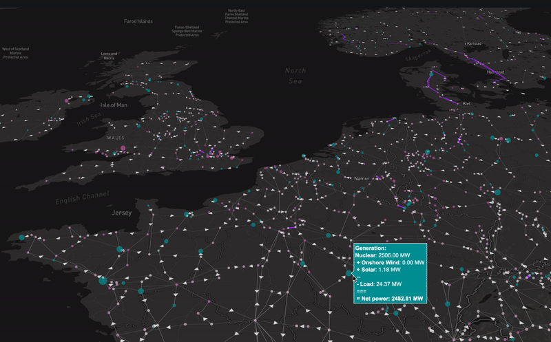
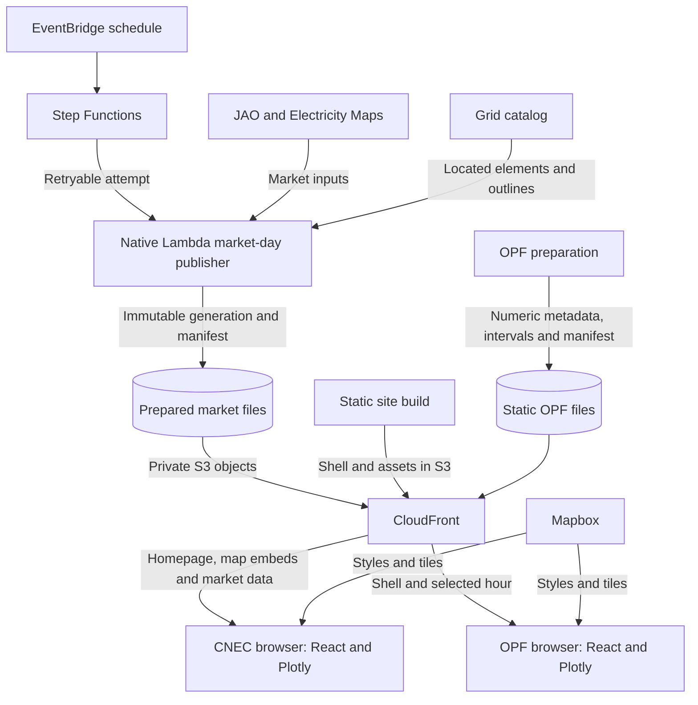

# Copper Sushi 🍣
## Electricity tools and 1.21 Gigawatts
[](https://121gigawatts.org/copper-sushi-power-flow-european-grid/)

This monorepo owns the power-flow and grid-constraint apps, price forecasting,
and the [1.21 Gigawatts Ghost theme and hosting](121gigawatts/README.md).
The power-flow app visualises optimisation solutions from
[`pypsa-eur`](https://github.com/PyPSA/pypsa-eur).

Product ownership: [Copper Sushi](coppersushi/README.md) contains the tools at
coppersushi.121gigawatts.org, including their frontend, pipelines and infrastructure.
[1.21 Gigawatts](121gigawatts/README.md) contains the blog at 121gigawatts.org.
[Forecasting](forecasts/README.md) retains its existing independent layout.

The web app is deployed
[**here**](https://121gigawatts.org/copper-sushi-power-flow-european-grid/),
along with an explanation of the main features.

The homepage `/` shows Critical Elements: prices and binding constraints.
`/cnec` opens the same map, and `/cnec/YYYY-MM-DD` selects a delivery day.
Power Flow is at `/opf-2024` (29 August 2024, hourly, on the 2025 grid). The CNEC view officially supports
delivery dates from **5 November 2025** onward. Historical publications through
31 October 2026 are verified; **2–9 June and 11 June 2026** are unavailable due to
[source gaps](wiki/jao-availability.md#historical-gaps). This cutoff does not apply to the separate OPF demonstration.

Both maps have header-free embeds: `/embed/cnec` (or `/embed/cnec/YYYY-MM-DD`)
and `/embed/opf-2024`. Critical Elements embeds retain their date, interval,
reference and element controls; URL query parameters work as on the full map.

```html
<iframe src="https://coppersushi.121gigawatts.org/embed/cnec"
        title="Critical Elements map" width="100%" height="650"
        style="border:0" loading="lazy"></iframe>
```

Model details: [power-flow architecture](wiki/sushi-2.md).

Networks are versioned with [Git LFS](https://git-lfs.com). Install `git-lfs` system-wide (`brew install git-lfs`)
so git works from any shell or IDE, run `git lfs install` once to register the filters that turn pointers into
files, then `git lfs pull`. The Pixi environment also includes `git-lfs` for commands run through `pixi run`.
Clone with `GIT_LFS_SKIP_SMUDGE=1` to skip the files, e.g. to run only the tests.

## System design



Components: [CNEC browser](coppersushi/frontend/README.md), [publication](coppersushi/pipelines/cnec/README.md),
[grid catalog](coppersushi/pipelines/grid/README.md), [OPF](coppersushi/pipelines/powerflow/README.md).
Prepared CNEC data is independent of request-time Python calculations. CloudFront serves the static CNEC shell and prepared files from private S3; OPF uses the same static hosting boundary.
The local Flask server previews those same files.

## Working with Agents
The repository is developed with coding agents (Claude Code and Codex), and the tooling for that is
part of the repository:

- [`AGENTS.md`](AGENTS.md) holds the rules the agents follow here. Every directory with rules of its own
  has one.
- [`.agents/skills/`](.agents/skills/) holds the skills those rules invoke.
- [`wiki/`](wiki/) is an LLM-maintained wiki of domain knowledge, design decisions and specs.

[Git hooks](git-hooks/README.md) owns the repository-wide checkout guard, its installer and tests.

## Local Installation
Install [Pixi](https://pixi.sh) 0.77.1 and Git LFS (for Git outside Pixi, including the IDE).
Supported development platforms are Apple Silicon macOS 15+ and Linux x86-64 (glibc 2.28+).
The default interpreter is Python 3.14.10. From the repository root, one command installs the locked environment:

```sh
pixi run --locked setup
```

Repeat the same command after pulling dependency changes. No credentials, solver runs,
cloud resources or large datasets are needed for setup or tests.
The standalone [CNEC browser](coppersushi/frontend/README.md) owns selection, market arithmetic
and map rendering. It loads prepared interval files; browsing never calls the
upstream market APIs. `setup` and `dev` build its assets with locked npm dependencies.
After changing frontend sources, run `pixi run frontend-build`; after changing wire
models, run `pixi run frontend-contracts`. `pixi run frontend-test` checks contract
drift, TypeScript and interaction behavior.

`pyproject.toml` defines Python packages and Pixi tools; `pixi.lock` pins both platforms.
Use `pixi add` / `pixi add --pypi` to change dependencies and commit both files.

In PyCharm, select an **existing local Python interpreter** at
`<checkout>/.pixi/envs/default/bin/python`. No Conda executable or Pixi plugin is needed.
Exclude `.pixi` from indexing. The default environment covers the app, forecasts and Ghost hosting Python;
the package is installed editable, so imports also work outside the repository directory.
Use Pixi to change packages, rather than the IDE's package installer.

`pixi run --locked <command>` supplies the environment's tools and activation variables.
Direct IDE Python runs use the interpreter's packages; external tools invoked by name
may also need the Pixi environment's `bin` directory on the run configuration's `PATH`.

### Mapbox Token
A Mapbox access token is required to run the app. Tokenless startup is unsupported.
Register for a free token at [mapbox.com](https://www.mapbox.com/), then paste it into
`.secrets/.mapbox_token`, or export it as `MAPBOX_TOKEN`.

Start the frontend preview against published data for both maps:

```bash
pixi run --locked dev
```

This builds local frontend assets and reads public datasets; it does not require a
local solved network or producer catalogs. To preview an unpublished Power Flow
network, use the exporter’s `--serve` command in [Power Flow preparation](coppersushi/pipelines/powerflow/README.md).

Producer preparation is separate: `pixi run --locked setup-app` pulls the solved
network, downloads cached locator inputs and builds catalogs and country outlines
under ignored `coppersushi/data/`. `pixi run --locked check-data` validates those
local inputs. Use `pixi run --locked setup-data --refresh` to refresh them, or add
`--day YYYY-MM-DD` to select an additional domain seed day.


Once the server starts, the web app will be available at http://localhost:8050

### Market Data

The CNEC view uses JAO constraints and Electricity Maps day-ahead prices. Put an
Electricity Maps key in `.secrets/.electricity_maps_api_key`, or export
`ELECTRICITY_MAPS_API_KEY`. Prepare a complete day before browsing:

```sh
pixi run --locked python -m coppersushi.pipelines.cnec.data_sources.bundles 2026-11-03 --directory coppersushi/data/browser
```

Preparation resolves elements through the [grid catalog](coppersushi/pipelines/grid/README.md).
Incomplete upstream publications remain unpublished; missing element locations are
explicit in the prepared data. See [publication](coppersushi/pipelines/cnec/README.md)
for the file contract and [deployment](coppersushi/infra/lambda/README.md) for S3 delivery.

## Running the Tests
```bash
pixi run --locked test
```
This runs app tests, forecast tests, forecast type checks, Ghost theme validation
and hosting configuration checks. Node 22, Yarn, Terraform, Make and Ansible are
installed by the same setup command. Theme npm packages retain `121gigawatts/yarn.lock`;
Terraform providers retain their `.terraform.lock.hcl` files.
The tests run against small checked-in fixtures under `coppersushi/testdata/`, never against the
networks. Tests require no Mapbox token; they build figures without fetching map tiles.

See the [CI design](.github/workflows/README.md) for GitHub Actions check groups,
parallelism, cache choices and the local container check.

## Solving a day with PyPSA-Eur
The networks in `coppersushi/networks/` are produced by [PyPSA-Eur](https://github.com/PyPSA/pypsa-eur),
run from a **sibling checkout** at `../pypsa-eur` pinned by `pypsa-eur.pin` (repository URL and
commit) with the configuration in `coppersushi/config/coppersushi.yaml`. Set it up once:
```bash
git clone https://github.com/PyPSA/pypsa-eur.git ../pypsa-eur  # the runner fetches the pinned commit from the URL in pypsa-eur.pin
(cd ../pypsa-eur && pixi install)
```
Then, from this repository:
```bash
pixi run --locked python -m coppersushi.pipelines.powerflow.data_sources.pypsa_eur solve
```
checks the sibling out at the pinned commit, runs the workflow (a first run downloads about
20 GB and takes an hour on a fast connection; later runs take minutes) and writes the solved
network to the gitignored `coppersushi/networks/candidates/opf-<day>-<pin>.nc`, previewable by exporting it with
`python -m coppersushi.pipelines.powerflow.data_sources.dataset <network-file> coppersushi/data/candidate-preview --serve`. Iterate as often as you like; when a solve is the one to keep,
```bash
pixi run --locked python -m coppersushi.pipelines.powerflow.data_sources.pypsa_eur promote coppersushi/networks/candidates/opf-<day>-<pin>.nc
```
copies it to `coppersushi/networks/opf-<day>.nc` and stages it — committing is the sanction, and each
committed version is a Git LFS object kept forever. Set `PYPSA_EUR_DIR` to use a checkout elsewhere. Design: [`wiki/pypsa-eur-sibling.md`](wiki/pypsa-eur-sibling.md).

## Production deployment

CloudFront serves the static app and prepared files from private S3. Follow the
[deployment runbook](coppersushi/infra/lambda/README.md) to publish frontend or hourly OPF updates.
Only market-data preparation uses a Lambda image; public page requests do not.

Dependencies compose in `pyproject.toml`: `build` adds PyPSA for offline figures and
`dev` adds local analysis and development tools. The native publisher image has its
own handler and omits the frontend and solved networks. Candidate solves remain
viewable locally through Dash.
