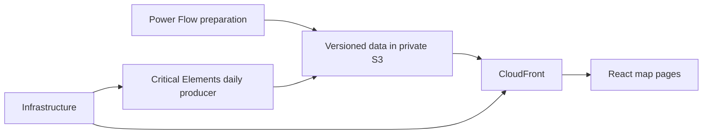

# Copper Sushi

Power and electricity-market tools at coppersushi.121gigawatts.org.
[Repository overview](../README.md) · [Frontend](frontend/README.md) · [Pipelines](pipelines/README.md) · [Infrastructure](infra/README.md)

The frontend owns map presentation and interaction. Pipelines prepare validated data;
infrastructure hosts files and runs background jobs. Browser interactions do not run
Python calculations. The blog belongs to `121gigawatts/`; forecasting has its own
existing package and is outside this product refactor.

`config/` contains tracked inputs, `networks/` contains solved networks under Git LFS,
and `data/` contains ignored local caches and generated publications. Shared workspace
tooling, dependency locks and credentials remain at the repository root. `PRODUCT`
and `REPO` in `__init__.py` distinguish these two roots explicitly.

Tests are colocated with their source. Checked-in fixtures live in each owning component’s `testdata/`; cross-component tests reuse them there.
Run `pixi run test-app` from the repository root. Agent files link to local READMEs;
architecture explanations belong in these READMEs, while local instructions describe
how to work within each boundary.
