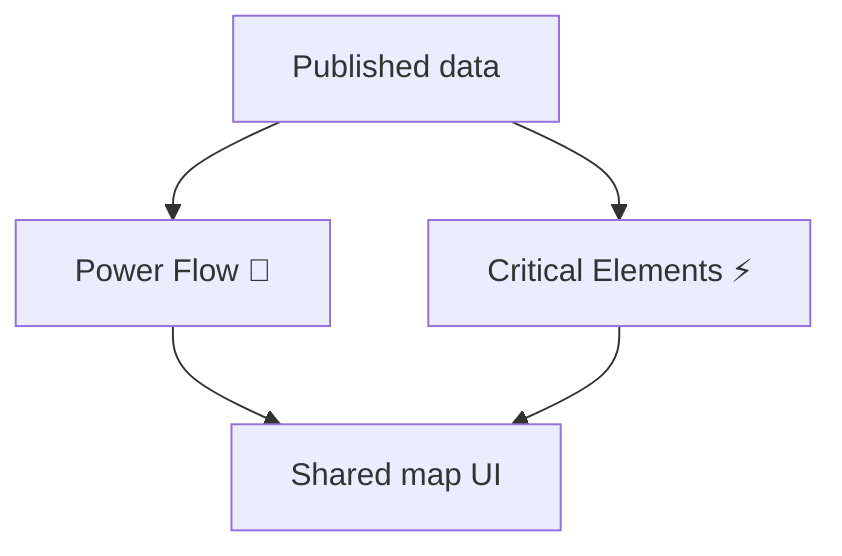

# Map frontend

[Product](../README.md) · [Pipelines](../pipelines/README.md)

Owns the React map pages and their browser presentation. `pages/powerflow/` constructs
network layers and tooltips from numeric snapshots; `pages/cnec/` owns market selection,
contributions and reference-country behavior. Both use the same map interface. Data loading and contracts
live with each page. There is no intermediate source directory.

`controls/map-controls.tsx` owns overlay composition and placement for both pages,
including loading and error messages in the grid row below help.
Pages supply legend units and range, help content, optional reference controls and
calendar capabilities. Power Flow uses a fixed day; Critical Elements supplies daily
availability. `IntervalControls` owns both pages’ date/time panel, interval buttons and slider. Domain fetching stays out of shared presentation components.

`map/` owns the measured map frame, render queue, Plotly lifecycle and tooltip gestures; feature-specific layers and calculations stay with
the page. Python shell assembly, browser schema generation (`contracts.py`) and asset
publication live in `packaging/`; they do
not fetch upstream market data or publish domain datasets.

From the repository root: `pixi run frontend-build`, `pixi run frontend-test` and
`pixi run frontend-contracts`. The latter regenerates browser contracts from Python
models. Tests are colocated. `scripts/build.mjs` builds into ignored `dist/`; source
assets live in `assets/`. The [deployment runbook](../infra/lambda/README.md) owns
production publication and rollback.

Polish export-cap tooltips read required and purchased upward reserve capacity from
the prepared interval object, including independent publication timestamps formatted
in Europe/Brussels. The browser never fetches PSE on hover. Missing evidence stays
explicit; upward capacity is not shown as an explanation of import constraints.
