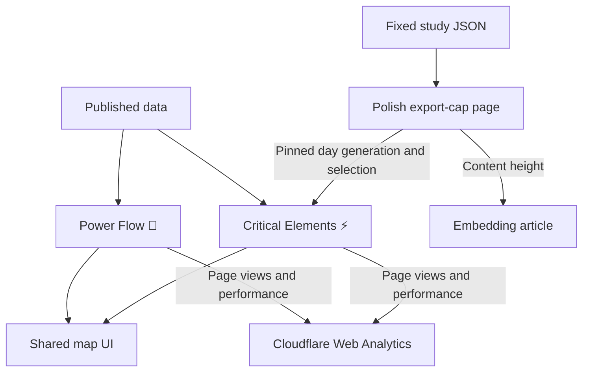

# Map frontend

[Product](../README.md) · [Pipelines](../pipelines/README.md)

Owns the React map pages and their browser presentation. `pages/powerflow/` constructs
network layers and tooltips from numeric snapshots; `pages/cnec/` owns market selection,
contributions and reference-country behavior. Both use the same map interface. `pages/polish-export-caps/` composes the native CNEC map with a fixed-study graphic and table. Data loading and contracts
live with each page. There is no intermediate source directory.

`controls/map-controls.tsx` owns overlay composition and placement for both pages,
including loading and error messages in the grid row below help.
Pages supply legend units and range, help content, optional reference controls and
calendar capabilities. Power Flow uses a fixed day; Critical Elements supplies daily
availability. `IntervalControls` owns both pages’ date/time panel, interval buttons and slider. Domain fetching stays out of shared presentation components.

`map/` owns the measured map frame, render queue, Plotly lifecycle and tooltip gestures; feature-specific layers and calculations stay with
the page. Python shell assembly, browser schema generation (`contracts.py`) and asset
publication live in `packaging/`; they do
not fetch upstream market data or publish domain datasets.

From the repository root: `pixi run frontend-build`, `pixi run frontend-test` and
`pixi run frontend-contracts`. The latter regenerates browser contracts from Python
models. Tests are colocated. `scripts/build.mjs` builds into ignored `dist/`; source
assets live in `assets/`. The [deployment runbook](../infra/lambda/README.md) owns
production publication and rollback.

Both page roots expose `data-load-state="loading|ready|error"` from required data
and current-figure completion. Background interval prefetch does not gate readiness.
Plotly 3.7.0’s Mapbox render promise waits for `map.loaded()` before completion;
this is lifecycle readiness, not a pixel-level assertion.

The shared HTML shell loads `assets/analytics.js` for both apps and their embeds.
It loads Cloudflare's cookie-free Web Analytics beacon only on
`coppersushi.121gigawatts.org`; local and preview hosts send no analytics.
The public site identifier shares the blog's analytics property; filter by Host
and Path to separate app, article and embed traffic. An article and its embedded
app report separate page views. CloudFront remains the app CDN; no Cloudflare
proxy is required. The beacon measures page views and performance, not map actions.

Polish export-cap tooltips read required and purchased upward reserve capacity from
the prepared interval object, including independent publication timestamps formatted
in Europe/Brussels. The browser never fetches PSE on hover. Missing evidence stays
explicit; upward capacity is not shown as an explanation of import constraints.

The investigation is directly linked at `/polish-export-caps`; the two-product
navigation stays unchanged. `/embed/polish-export-caps/breakdown` renders only the
fixed-population graphic and sources; `/embed/polish-export-caps/intervals` renders
the map and table. All matching rows scroll independently under sticky column
headers and filters, with the map visible above. Date bounds, numeric filters,
sort order, interval selection and camera are stored in the URL. Filtering never
changes the graphic population or removes the map selection. The study pins its
validated CNEC generations so later daily corrections cannot silently change its
evidence. See the [publication runbook](../infra/lambda/README.md#fixed-export-cap-study).

For an article that follows the height of either Polish study embed, include
``
immediately after its iframe. Set an initial iframe height for loading. The embed
reports content height as the disclosure opens or closes and the layout wraps.
