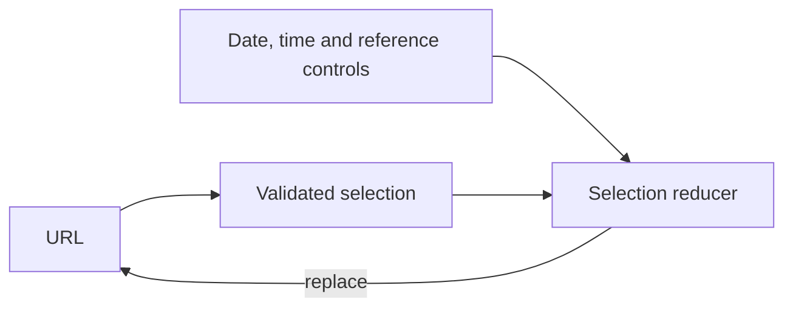

# Selection and controls

[Browser architecture](../README.md)

A pure reducer handles intent; URL parsing validates deep links. History replacement keeps interval browsing from flooding browser history. Controls describe the requested view while pending data remains visible.

[market](../pages/cnec/market/README.md) · [data](../pages/cnec/data/README.md) · [map](../map/README.md)

`MapControls` positions legends, help, optional reference controls, status messages and the bottom panel. `IntervalControls` owns the time buttons and slider for both pages. Its date slot takes either a fixed date or `CalendarDateControls`; the CNEC page supplies calendar availability. Loading does not change the panel geometry.
