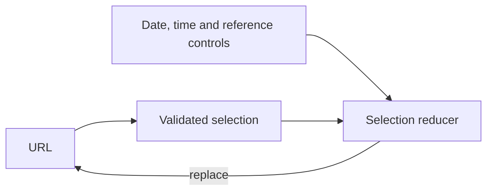

# Selection and controls

[Browser architecture](../../README.md)

A pure reducer handles intent; URL parsing validates deep links. History replacement keeps interval browsing from flooding browser history. Controls describe the requested view while pending data remains visible.

[market](../market/README.md) · [data](../data/README.md) · [map](../map/README.md)
