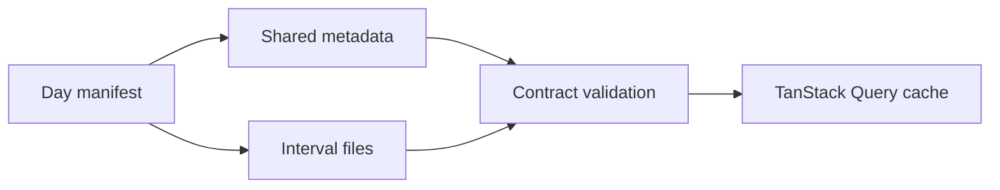

# Publication loading

[Browser architecture](../README.md)

Validates the generated Python contract at entry. Shared query keys keep selected-interval and background loading on the same requests. Immutable generation URLs prevent mixed revisions.

[market](../pages/cnec/market/README.md) · [map](../map/README.md) · [controls](../controls/README.md)
