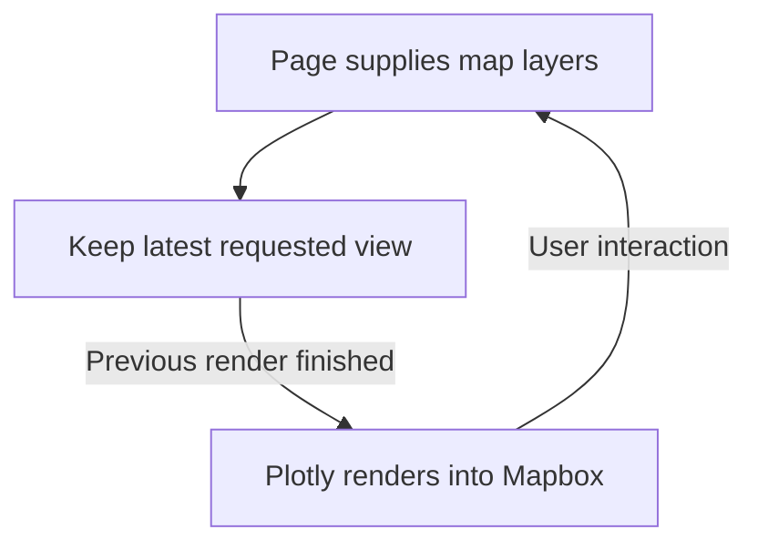

# Map rendering

[Browser architecture](../README.md)

Owns both pages’ measured map frame, render queue, tooltip gestures, the Plotly lifecycle and native Mapbox adapter. Page-specific figure construction lives beside each page. Stable layout and insertion targets retain layers across updates. Mapbox owns country labels, collision placement and camera movement. Prices update through one persistent GeoJSON source with fading disabled. Electric decoration uses the same camera.

[market](../pages/cnec/market/README.md) · [data](../pages/cnec/data/README.md) · [controls](../controls/README.md)

`map-graph.tsx` owns the displayed snapshot and the latest pending request through the pure `render-state.ts` reducer. `plot.tsx` calls public `Plotly.react` directly; only settlement of that promise completes a render. Native camera events cannot advance the queue. A paint separates renders; intermediate requests are discarded. Failed or unfinished figures do not accept selection. Plotly’s responsive configuration owns resize handling. `map-frame.tsx` measures the mounted container for initial bounds fitting; later updates preserve the user’s camera. Renderer errors are reported to the page and displayed through the shared `MapControls` status area.

`map-gestures.ts` owns hover dismissal and a single gesture origin. Canvas gestures retain their click target until the final click; a separate tooltip gesture dismisses it. Native projection and public hover APIs refresh touch hits. Country-label hits are captured at pointer-down and consumed before Plotly selection. The reference dropdown remains the keyboard-accessible alternative. Decoration is mounted inside the native map container below the tooltip SVG.
