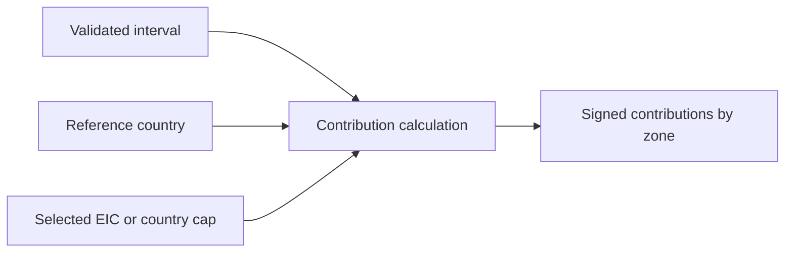

# Market arithmetic

[Browser architecture](../../../README.md)

Pure signed contributions for physical constraints and country caps. The real-data reconciliation tests run here without importing Plotly or React.

[data](../data/README.md) · [map](../../../map/README.md) · [controls](../../../controls/README.md)

Physical selection sums every binding row with the selected EIC, including different branches, directions and contingencies. Missing required sensitivities remain unavailable. An asset with no binding rows contributes zero. Individual published shadow prices remain separate in map tooltips.
