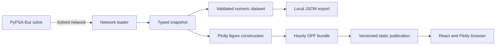

# OPF

[System overview](../../README.md) · [Domain model](../../wiki/sushi-2.md)

Owns solved-network loading, snapshot extraction, hourly figure preparation and
power-flow rendering. The static browser loads published hourly figures; local candidates render through Dash. External
I/O lives in `data_sources/`; the remaining modules transform in-memory values.



`data_sources/pypsa_eur.py` runs and promotes solves; `networks.py` loads them.
`snapshot.py`, `shedding.py` and `power_flow.py` derive the view.
`data_sources/opf_bundle.py` prepares token-free hours and UTC timestamps.
`data_sources/publication.py` publishes immutable generations and their manifest to S3.
The [browser](../../frontend/README.md) loads selected hours through CloudFront.
Candidate solves remain local analysis through `app.py`; public page requests
neither load solved networks nor construct figures in Python.

## Data-only export

`dataset.py` defines the v2 numeric contract; `export.py` reuses the existing
snapshot calculations without constructing figures or HTML tooltips. Nodes carry
WGS84 coordinates and voltage; branches retain component/name identity and bus0
orientation. Intervals contain MW values and generator availability. Optional
missing values are null, not zero. Validation rejects incomplete snapshots,
invalid coordinates, duplicate identities and non-finite numbers.

Export a solved network locally:

```sh
python -m coppersushi.opf.data_sources.dataset networks/opf-2024-08-29.nc /tmp/opf-data.json
```

Run its colocated checks with `python -m pytest coppersushi/opf/test_dataset.py`.
This local data export does not change the published v1 figures or browser contract.
