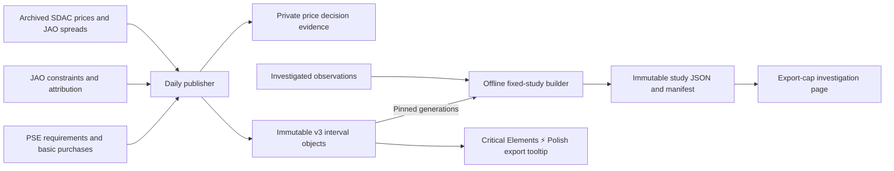

# Critical Elements pipeline

[Product pipelines](../README.md) · [Frontend](../../frontend/README.md) · [Grid](../grid/README.md)

Owns market-day calculations, price attribution and complete
daily publication. `interval.py`, `prices.py` and `attribution.py`
transform typed inputs; `data_sources/` uses the shared JAO source and market archive, fetches optional PSE reserve evidence, builds bundles and
runs scheduled publication. `models.py` defines the browser publication contract.

Grid preparation supplies static geography; each daily run fetches and validates
market inputs, writes immutable objects, then advertises a complete generation by
updating its manifest. Failures leave the previous publication usable. The frontend
handles interactive selection locally. Hosting and scheduling belong to
[infra](../../infra/README.md), not these calculations.

The schedule, readiness checks, retry policy and backfill commands are documented in
the [runbook](../../infra/lambda/README.md). Run colocated tests through `pixi run
test-app` and regenerate changed contracts with `pixi run frontend-contracts`.

The publisher requires every Core zone and interval. It can recover a missing
price from an eligible absolute price and signed JAO spreads. For each output
generation, `market-data/decisions/cnec/` pins the cutoff, source policy and
evidence for each price in private S3 storage. Local publication writes this
evidence next to the preview directory. The scheduled publisher keeps the missing
zone intervals and related attempts in a private record when archive coverage is
incomplete. A deliberate pre-archive backfill uses `--legacy-prices`.
When a backfill audit passes and a manifest already exists, its report records
`existing` and the cutoff used for the audit. Backfill creates the manifest only
if the key is absent. If another writer publishes first, backfill verifies that
writer's manifest before reporting `existing`. The report records `published`
when that run publishes a generation. Resuming an archive checkpoint requires the
same cutoff mode and, for an explicit replay, the same instant.

Reserve versions are selected independently before 10:30 Brussels on D−1.
Unavailable reserve evidence does not block market publication. Use the existing
explicit refresh command to enrich a previously published day; scheduled runs skip it.

`investigation.py` validates the fixed study contract, including complete calendar
coverage, distinct binding intervals, reserve components and publication cutoffs.
`python -m scripts.polish_cap_page build` reconciles the investigated baseline and
prepared extension against immutable map intervals before writing a study. It
fails on missing evidence or changed counts. Its `publish` command uploads the
immutable artifact before the manifest; it does not run on the daily schedule.
Inputs and generated price-bearing data stay out of Git. Build and publication
commands live in the [runbook](../../infra/lambda/README.md#fixed-export-cap-study).
