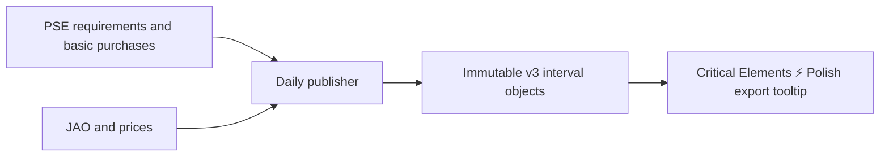

# Critical Elements pipeline

[Product pipelines](../README.md) · [Frontend](../../frontend/README.md) · [Grid](../grid/README.md)

Owns market-day calculations, constraint normalization, price attribution and complete
daily publication. `elements.py`, `interval.py`, `prices.py` and `attribution.py`
transform typed inputs; `data_sources/` fetches JAO, prices and optional PSE reserve evidence, builds bundles and
runs scheduled publication. `models.py` defines the browser publication contract.

Grid preparation supplies static geography; each daily run fetches and validates
market inputs, writes immutable objects, then advertises a complete generation by
updating its manifest. Failures leave the previous publication usable. The frontend
handles interactive selection locally. Hosting and scheduling belong to
[infra](../../infra/README.md), not these calculations.

The schedule, readiness checks, retry policy and backfill commands are documented in
the [runbook](../../infra/lambda/README.md). Run colocated tests through `pixi run
test-app` and regenerate changed contracts with `pixi run frontend-contracts`.

Reserve versions are selected independently before 10:30 Brussels on D−1.
Unavailable reserve evidence does not block market publication. Use the existing
explicit refresh command to enrich a previously published day; scheduled runs skip it.
