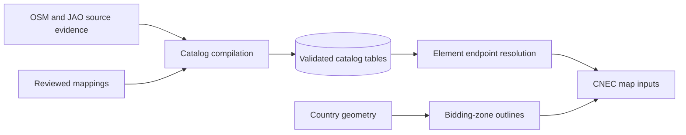

# Grid catalog

[System overview](../../README.md) · [Catalog input schema](../../config/element-catalog/README.md)

Owns physical site and element identity, endpoint resolution and country outlines.
Its output is geographic evidence, independent of the price or rendering model.
External I/O lives in `data_sources/`; geometry matching transforms validated inputs.

`data_sources/element_catalog.py` loads and resolves the catalog;
`catalog_backfill.py` and `catalog_sweep.py` compile source evidence.
`cnec_geometry.py` implements matching; `bidding_zones.py` and `static_grid.py`
handle geography. Country preparation feeds the application build alongside
[OPF preparation](../powerflow/README.md).
