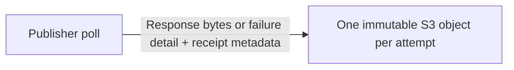

# Market data

[Data pipelines](../README.md)

The landing store preserves independent day-ahead price polls in a private S3 bucket.
Call `data_sources.s3.save_attempt` with a typed receipt and the response bytes,
including empty and HTTP error bodies. For transport failures supply the reason
without credentials. Retry an interrupted write with the same receipt and attempt ID.
A new poll gets its own ID even when its bytes match an earlier response.

`read_attempt` retrieves one receipt. Its timestamp establishes receipt only.
