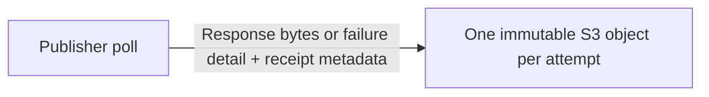

# Market data

[Data pipelines](../README.md)

The landing store preserves independent day-ahead price polls in a private S3 bucket.
Call `data_sources.s3.save_response` with the poll and response bytes, including
empty and HTTP error bodies. It returns a receipt with the digest of the stored
bytes. Use `save_failure` for a transport failure and its redacted reason. Retry an interrupted write with the same receipt and attempt ID.
A new poll gets its own ID even when its bytes match an earlier response.

`read_attempt` retrieves one receipt. Its timestamp establishes receipt only.
