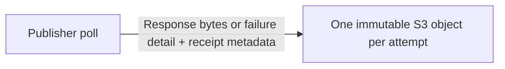

# Market data

[Data pipelines](../README.md)

What did the publisher return, and when did we receive it? For each day-ahead
price request, this package saves the response bytes and their arrival time, or
the reason the request failed. Look up a poll by its attempt ID with
[`read_attempt`](data_sources/poll_receipts.py). A price can still be awaiting
validation at the forecast deadline even though its response has arrived.

## Poll storage

To inspect the bytes archived for an attempt, call `read_response` with its ID.
It returns the receipt and checksum-verified bytes, including empty responses and
HTTP error pages. For a transport failure it raises `NoResponseBody` with the recorded reason.

Each poll occupies one immutable object in private S3. `save_response` stores
the bytes, including empty and HTTP error bodies, and returns their checksum in
the receipt. `save_failure` records a transport failure and its redacted reason.
Retry an interrupted write with the same attempt ID and evidence. A new request
gets a new ID even when the publisher returns identical bytes.

