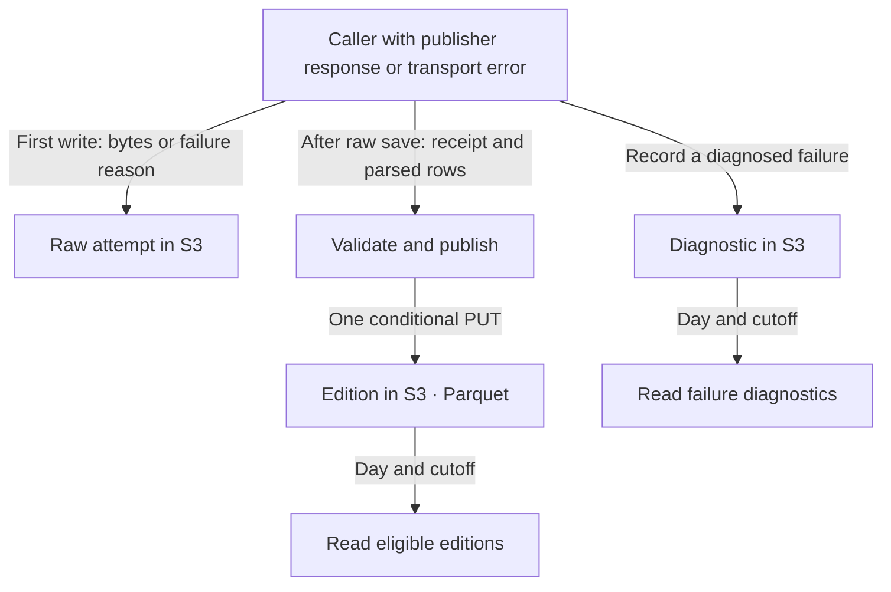

# Market data

[Data pipelines](../README.md)

An **edition** is the validated price or border-spread table from one publisher response. For a delivery day and cutoff, the archive returns every eligible edition, including zero-row tables and earlier versions later corrected.

Suppose a response arrives at 10:58 and its edition reaches S3 at 11:04. An 11:00 replay returns nothing. An 11:05 replay returns that edition. If a correction reaches S3 at noon, a 12:01 replay returns both.

## Write and read an edition

1. Save the response with [`save_response`](data_sources/responses.py). It returns the receipt once the raw bytes are durable. A transport error goes through `save_failure`.
2. Parse the bytes held by the caller. Pass the receipt and rows to [`publish_edition`](data_sources/editions.py). It validates the [price or spread schema](edition_models.py) and writes one immutable Parquet object. A retry with identical evidence preserves the original publication time.

Use `read_editions(client, bucket, day, cutoff)` for the validated tables. S3 reports publication to the second, so the reader excludes objects written during the cutoff second.

## Inspect an attempt

[`read_response`](data_sources/responses.py) returns the receipt and exact archived bytes, including an empty body or an HTTP error page. A transport failure raises `NoResponseBody` with the recorded reason. A parse failure leaves the raw bytes available for inspection.

[`read_day_diagnostics`](data_sources/responses.py) returns failures recorded by cutoff. A raw receipt alone means the outcome is still unknown.
