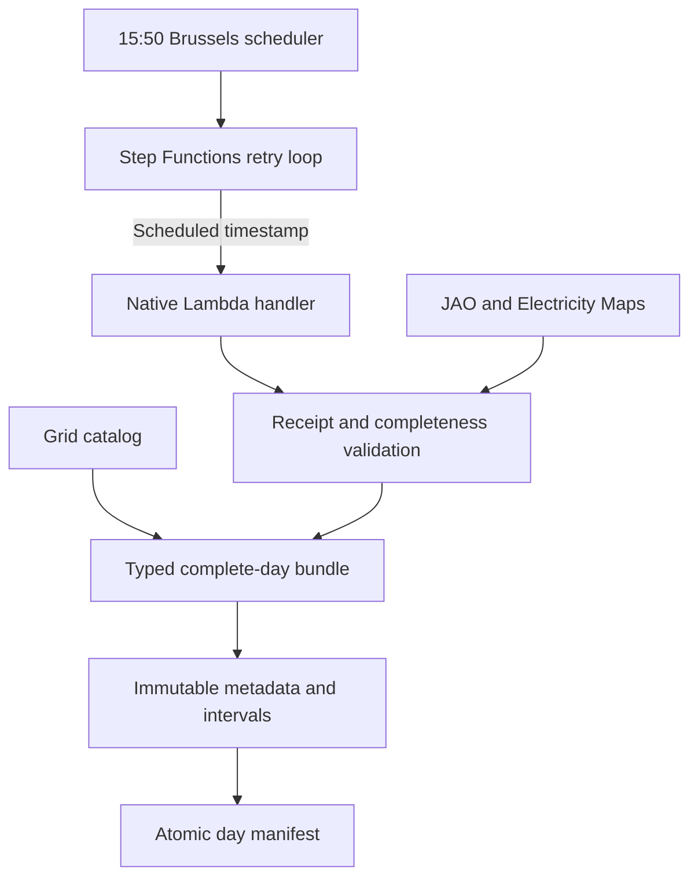

# Market-day publication

[System overview](../../README.md) · [Browser](../../frontend/README.md) · [Deployment](../../infra/lambda/README.md) · [Grid catalog](../grid_catalog/README.md)

Prepares complete market days as immutable browser data. JAO receipt evidence and
complete prices/context are required before the manifest exposes a generation.
There is no serving process in this component. `bundle.py` and `models.py` define
pure conversion and the wire contract; `data_sources/` owns fetching and writing.

Run `python -m coppersushi.publication.data_sources.bundles YYYY-MM-DD --directory data/browser`
for local files, or use `--bucket` to publish to S3. `--refresh` requests upstream
corrections. Publication rejects partial days; metadata and every interval are
written before the manifest. Old generations remain readable by in-flight clients.

`job.py` pins tomorrow's delivery day to the original scheduled instant. `handler.py`
validates the Lambda event; `data_sources/scheduled.py` makes one attempt. The
workflow waits two minutes between incomplete publications, for at most five hours.
A complete manifest skips re-publication. Unexpected errors remain visible failures.
The `publisher` image includes catalog inputs and outlines, without solved networks,
OPF figures or a web server. It uses AWS's official Runtime Interface Client.
