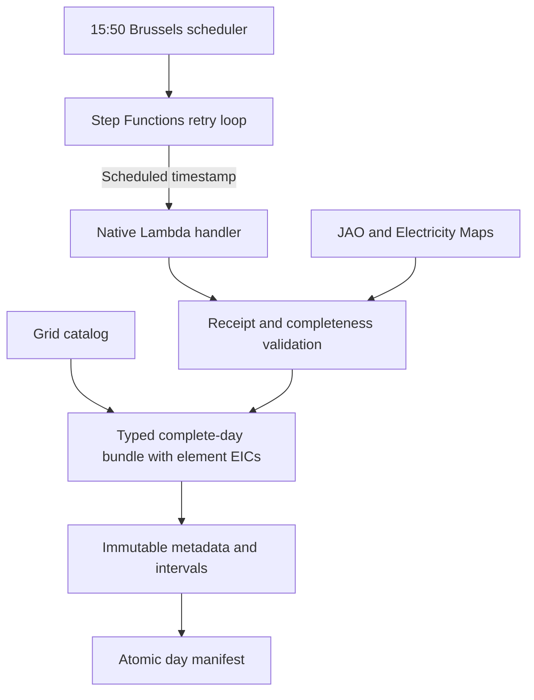

# Market-day publication

[System overview](../../README.md) · [Browser](../../frontend/README.md) · [Deployment](../../infra/lambda/README.md) · [Grid catalog](../grid_catalog/README.md)

Prepares complete market days as immutable browser data. JAO receipt evidence and
complete prices/context are required before the manifest exposes a generation.
There is no serving process in this component. `bundle.py` and `models.py` define
pure conversion and the wire contract; `data_sources/` owns fetching and writing.



Run `python -m coppersushi.publication.data_sources.bundles YYYY-MM-DD --directory data/browser`
for local files, or use `--bucket` to publish to S3. `--refresh` requests upstream
corrections. Publication rejects partial days; metadata and every interval are
written before the manifest. Old generations remain readable by in-flight clients.

`job.py` pins tomorrow's delivery day to the original scheduled instant. `handler.py`
validates the Lambda event; `data_sources/scheduled.py` makes one attempt. The
workflow waits two minutes between incomplete publications, for at most five hours.
A complete manifest skips re-publication. Unexpected errors remain visible failures.
The `publisher` image includes catalog inputs and outlines, without solved networks,
OPF figures or a web server. It uses AWS's official Runtime Interface Client.

Every physical binding row carries its required published EIC. Asset selection and aggregation use EIC; publication row IDs identify individual constraints and their PTDFs. Regenerate prepared days when this contract changes.

## Historical backfill

Audit a historical range before publishing. Run one process at a time so JAO's
shared process limiter controls the aggregate request pace. The range CLI starts
at 90 requests/minute with up to four independent attribution feeds in flight.
HTTP 429 pauses all queued JAO calls using `Retry-After` (60 seconds if missing
or invalid), reduces the shared rate by 20% (down to 40/minute), and retries a request up to three
times. Other consumers retain the conservative 40/minute, fail-fast policy.
`--jao-requests-per-minute 180` enables an explicit measured trial above JAO’s
published 100/minute quota; shared cooldowns and retries still apply. The default
remains 90/minute. Use job supervision
for long ranges. Reports contain source evidence and errors, and belong in ignored
`data/`, not Git:

```sh
python -m coppersushi.publication.data_sources.backfill 2025-11-05 2026-10-31 --report data/backfill/coverage.jsonl
```

Add `--bucket <cache_bucket>` to publish eligible days. Repeating a command skips
successful report entries and retries blocked days. Existing S3 manifests are
preserved. The command exits with status 1 if any attempted day is blocked.
Each report line records monitoring receipts, physical active/PTDF row counts,
expected market intervals, missing Polish alternatives and unavailable intervals.
Historical `Shadow Prices: Received` is accepted when the renamed `Active FB
Constraints` receipt is absent; an explicit new-label status takes precedence.
See [monitoring labels](../../wiki/literature/jao-core-publication-handbook.md#monitoring-labels).
A nonempty constraints response never substitutes for a missing receipt; inspect
adjacent monitoring dates, page names and statuses before choosing independent
historical evidence. Such days remain blocked by this workflow.

The backfill permits missing Polish alternative prices while retaining complete
alpha, allocation limits, net positions and Core prices. Missing alternatives do
not prove that caps were absent: safely interior positions establish nonbinding
caps; near a bound, interval notes expose unavailable Polish attribution in the
browser. See [publication coverage](../../wiki/country-import-export-caps.md#publication-coverage).
The one-day CLI provides the same policy through `--allow-partial-attribution`.
Alpha values up to `1e-6` outside `[0, 1]` are snapped to the nearest bound
at input loading, including cached inputs. Larger violations are rejected;
in-range values are preserved. Scheduled publication stays strict. The browser's
supported history starts on 5 November 2025, with 352 verified historical days
through 31 October 2026 and nine accepted [unavailable dates](../../wiki/jao-availability.md#historical-gaps).
