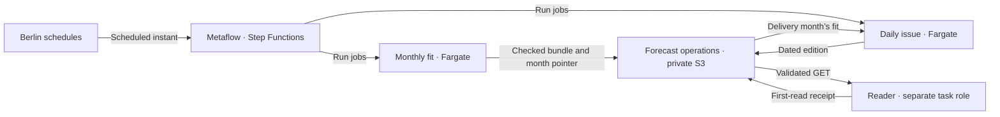

# Day-ahead price forecasts

Forecast the DE–LU auction price for each quarter of tomorrow’s Berlin delivery day. Each issue contains five price quantiles from the fitted model and five from the seasonal reference. The information deadline is 11:00 Berlin on the preceding day. [Scientific contract](../wiki/price-forecasting/germany-luxembourg.md) · [Recorded result](../wiki/price-forecasting/evaluation.md#result)

## Follow one forecast

| What you want to inspect | Where to start |
|---|---|
| Which price versions were eligible at the deadline? | [Inputs](inputs/README.md) |
| Which features enter the monthly fit and the daily prediction? | [Model](model/README.md) |
| Where do realised prices enter, and how are the two methods scored? | [Evaluation](evaluation/README.md) |
| Which inputs, code and models produced this run? How can I reproduce it? | [Execution](execution/README.md) |
| How do I inspect one day and its uncertainty bands in a tracked evaluation? | [Viewer](web/README.md) |

The product root holds the public commands and three shared contracts: [run settings](config.py), [Berlin delivery times](market.py), and [source fingerprints](provenance.py). The [registered settings](run-config.json) and [result receipt](reports/evaluation.json) identify the comparison reproduced by the runner and shown by the viewer.

## AWS operations



[Retrieve, trace and retry a forecast](operations/README.md) · [AWS infrastructure](infra/aws/README.md)

## On-demand day-ahead forecast

From the repository root, use the [locked Pixi environment](../README.md#local-installation). The November fit needs a verified training snapshot covering the October 2025 warmup through October 31, 2026. Fit once for that delivery month. Set `DELIVERY_DATE` to the Berlin delivery day and use that month’s fit. Use a new output path for each edition.

```sh
pixi run --locked python -m forecasts.monthly_fit --fit-day 2026-11-01 --snapshot "$TRAINING_SNAPSHOT" --output "$MONTHLY_FIT"
: "${DELIVERY_DATE:?Set the Berlin delivery date in YYYY-MM-DD format}"
EDITION="forecast-${DELIVERY_DATE}.json"
pixi run --locked python -m forecasts.daily --delivery-date "$DELIVERY_DATE" --archive-bucket "$COPPERSUSHI_CACHE_BUCKET" --run "$MONTHLY_FIT" --output "$EDITION"
pixi run --locked python -m forecasts.daily --read "$EDITION"
```

[Monthly fitting](monthly_fit.py) publishes the bundle. [Daily issuance](daily.py) checks its identity, selects free-source prices visible at issue time and records each price's evidence in the edition. A required price missing before the deadline makes the attempt retryable and reports all affected quarters. A late attempt records a missed edition and exits with status 1. Conflicting archive prices stop the attempt immediately and record a missed edition with the conflicting receipts. After investigating the receipts, use a fresh output path for any manual rerun. The read command validates a live issued edition before recording the first successful read in the adjacent `.availability.json` file.
Use a local filesystem that updates the surviving inode's change time when a hard link is removed and supports atomic rename. Keep published editions in place with their file metadata intact. The reader can accept a live edition once the staging name is removed. The inode change time must precede the deadline. The edition's `issued_at` records the publisher's time before the final filesystem operations.

Use `--replay` with the market archive to reconstruct the prices available at the 11:00 cutoff. Use `--replay --snapshot PATH` for historical reconstruction under a frozen snapshot's recorded timing assumptions. The output records reconstruction mode even when required prices are missing. Evaluation uses its pinned snapshot.

### Monthly training from the market archive

Use the November prices-only bundle `ef683f971ef0b733b5f7ad0b` for the frozen configuration and snapshot identity. Audit each feature at its historical issue deadline and the reference history and labels at the fit cutoff. Use a fresh coverage directory for each attempt.

```sh
pixi run --locked python -m forecasts.monthly_fit --fit-day 2026-12-01 --config "$NOVEMBER_FIT/config.json" --snapshot "$TRAINING_SNAPSHOT" --archive-bucket "$COPPERSUSHI_CACHE_BUCKET" --coverage-output "$COVERAGE_DIR" --audit-only
```

`coverage.json` reports counts. `selections.parquet` identifies each interval, cutoff, source, receipt or snapshot row version, and any gap. For a price conflict, the report identifies the affected quarter and its competing receipts. For a rejected frozen version, it records the timing evidence and reason. An unreadable receipt identifies the affected source day and cutoff. Any unresolved quarter fails the audit. Once the fit cutoff has passed and the frozen-row and daily-issuance comparisons pass, replace `--audit-only` with `--output "$MONTHLY_FIT"` and choose a fresh `--coverage-output`. The fit saves its audited selections in the bundle.

## Local model evaluation

```sh
pixi run --locked python -m forecasts.evaluation --snapshot "$BASELINE_SNAPSHOT" --output "$NEW_EVALUATION_DIRECTORY"
```

Use the immutable snapshot named in [run-config.json](run-config.json) for the registered evaluation. Read the [evaluation workflow](evaluation/README.md) to follow the registered nine monthly folds. Use [tracked execution](execution/README.md) to retain a reproducible run.

## Forecasts

[Open a saved run in the viewer](web/README.md). Its **How it works** view explains the computation. [Source evidence](evidence/README.md) and [research decisions](../wiki/price-forecasting/research/index.md) document the basis for comparisons.

## Development

```sh
pixi run --locked test-forecast
pixi run --locked typecheck
pixi run --locked component-imports
```

The [archive audit](source_audit/README.md) checks the retained price, weather and demand sources. Its recorded-year test needs `FORECAST_BASELINE_SNAPSHOT` set to the verified historical snapshot directory. [Infrastructure](infra/README.md) owns private S3 storage.
