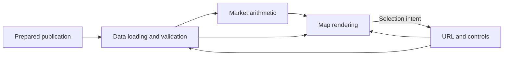

# CNEC browser

[System overview](../README.md) · [Publication contract](../coppersushi/publication/README.md)

A standalone React application constructs the map and calculates contributions
from prepared market-day files. Selection lives in the URL; query keys share
selected-interval and background requests. No interaction requests a Python figure.

Components: [data](src/data/README.md), [market](src/market/README.md),
[map](src/map/README.md), [controls](src/controls/README.md).
`index.tsx` composes them; `bootstrap.tsx` validates configuration and loads the
basemap. Build with `npm ci && npm run build` in this directory.
