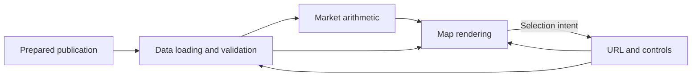
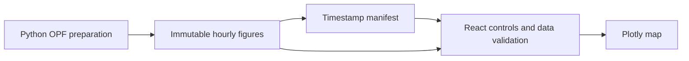

# CNEC browser

[System overview](../README.md) · [Publication contract](../coppersushi/publication/README.md)

A standalone React application constructs the map and calculates contributions
from prepared market-day files. EIC asset selection lives in the URL and persists when an asset is not binding; query keys share
selected-interval and background requests. No interaction requests a Python figure.



Components: [data](src/data/README.md), [market](src/market/README.md),
[map](src/map/README.md), [controls](src/controls/README.md).
`index.tsx` composes them; the [map component](src/map/README.md) owns render completion and input gestures; `bootstrap.tsx` validates configuration and loads the
basemap. Build with `npm ci && npm run build` in this directory.

## Static site

`packaging/` owns Python shell assembly and deployment tools; browser code lives in
`src/`. Domain data preparation and publication belong to the owning Python package.

`index.html` owns the CNEC shell. `navigation.html` supplies static navigation to
the CNEC and OPF shells;
`assets/navigation.css` owns the shared styling. `/` and `/cnec/:day?` show navigation;
`/embed/cnec/:day?` uses the same shell without it. Embed interactions retain
the embed route. `python -m frontend.packaging.publish --bucket <bucket>` embeds
the public Mapbox token and publishes built assets before the normal and embedded shells. It does not
import a web framework. The browser determines the current market date itself.
For local preview, `cnec_server.py` serves the same shell and `data/browser` files.
To use current production data with local frontend assets instead:

```sh
python -m flask --app 'cnec_server:create_app(production_data=True)' run --port 8765
```

Only prepared-data requests are proxied to the public production site.
Production routing and rollback are in the [hosting runbook](../infra/lambda/README.md).

## Static Power Flow

`src/opf/` validates a versioned timestamp manifest and selected Plotly hour. It owns
local-time labels, noon selection and controls; `map/plot.tsx` and `map/render-state.ts`
provide rendering and latest-selection queuing without CNEC overlays.



Prepare a local preview:

```sh
pixi run --locked -e build python -m coppersushi.opf.data_sources.opf_bundle
pixi run --locked python -m coppersushi.opf.data_sources.publication --directory data/opf-2024 --output data/browser/data/opf/v1/opf-2024
```

The standalone Flask preview serves `/opf-2024` and `/embed/opf-2024` with local OPF
files even when CNEC uses production data. Publish OPF hours separately with
`python -m coppersushi.opf.data_sources.publication --directory data/opf-2024 --bucket <bucket>`; hours are
uploaded under a content-derived generation before the mutable manifest.
