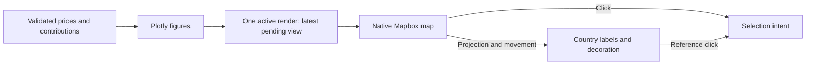

# Map rendering

[Browser architecture](../../README.md)

Owns Plotly figures and the native Mapbox adapter. Stable layout and insertion targets retain layers across updates. React owns country text; native movement callbacks position it synchronously. Electric decoration uses the same camera.

[market](../market/README.md) · [data](../data/README.md) · [controls](../controls/README.md)

`render-state.ts` coalesces full map snapshots before they reach the React Plotly promise queue. Initialization/update completion advances directly to the latest pending view; intermediate requests are discarded. Labels and interaction meaning follow the accepted snapshot, and map selection is disabled while it is being applied.
