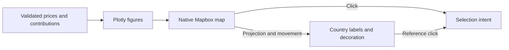

# Map rendering

[Browser architecture](../../README.md)

Owns Plotly figures and the native Mapbox adapter. Stable layout and insertion targets retain layers across updates. React owns country text; native movement callbacks position it synchronously. Electric decoration uses the same camera.

[market](../market/README.md) · [data](../data/README.md) · [controls](../controls/README.md)
