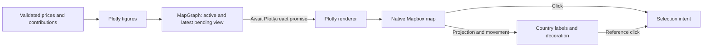

# Map rendering

[Browser architecture](../../README.md)

Owns Plotly figures and the native Mapbox adapter. Stable layout and insertion targets retain layers across updates. React owns country text; native movement callbacks position it synchronously. Electric decoration uses the same camera.

[market](../market/README.md) · [data](../data/README.md) · [controls](../controls/README.md)

`map-graph.tsx` owns the displayed snapshot and the latest pending request through the pure `render-state.ts` reducer. `plot.tsx` calls public `Plotly.react` directly; only settlement of that promise completes a render. Native camera events cannot advance the queue. A paint separates renders; intermediate requests are discarded. Failed or unfinished figures do not accept selection. Plotly’s responsive configuration owns resize handling.

`map-gestures.ts` owns hover dismissal and a single gesture origin. Canvas gestures retain their click target until the final click; a separate tooltip gesture dismisses it. Native projection and public hover APIs refresh touch hits. Decoration and country labels are mounted inside the native map container below the tooltip SVG.
