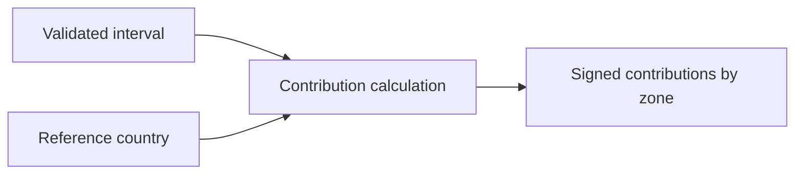

# Market arithmetic

[Browser architecture](../../README.md)

Pure signed contributions for physical constraints and country caps. The real-data reconciliation tests run here without importing Plotly or React.

[data](../data/README.md) · [map](../map/README.md) · [controls](../controls/README.md)
