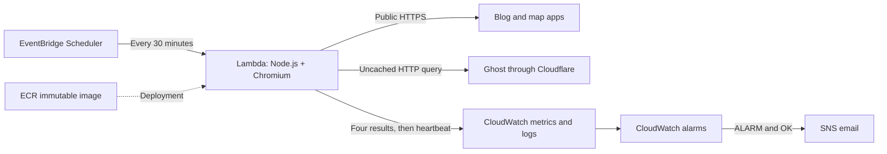

# Website monitoring

[System architecture](../README.md#system-design) · [Working spec](../specs/website-monitor.html)

Owns browser checks of the blog and both map apps, plus an uncached Ghost HTTP
probe. Product code owns its readiness state. The runner uses one Chromium process
and three isolated contexts concurrently; a page failure cannot cancel its peers.



## Build and check

From the repository root:

```sh
npm ci --prefix monitoring
node monitoring/node_modules/playwright-core/cli.js install chromium
npm test --prefix monitoring
LOCAL_BROWSER=1 npm run probe --prefix monitoring
docker build --platform linux/amd64 --provenance=false -t website-monitor:dev monitoring
docker run --rm --platform linux/amd64 -e AWS_EXECUTION_ENV=AWS_Lambda_nodejs22.x --entrypoint node website-monitor:dev dist/src/probe.js
```

The probe reads production but publishes no metrics or emails. Tests use a local
fixture server and real headless Chromium; no production data is needed.
Playwright and the Lambda Chromium package are pinned to Chromium 153.
WebGL stays enabled through SwiftShader. Browser contexts retain web security.

The production handler requires `METRIC_NAMESPACE` and an event containing
`scheduledTime`, an ISO timestamp supplied by EventBridge Scheduler. Work older
than two minutes is rejected. Results use that timestamp so retries do not create
extra evaluation periods. A completed heartbeat is published only after all four
result metrics succeed. Browser startup or metric publication failure produces
no heartbeat.

## Success and diagnostics

The blog must show its footer site identity and a linked article title. Map pages must expose
`data-load-state="ready"`, a visible Mapbox canvas inside the expected product renderer and an interval slider. Missing expected
page content, readiness timeout/error and uncaught application exceptions fail a check.
Network failures and other console errors remain diagnostics. A recovered request
passes if the page becomes ready; the monitor does not infer required data from
request order or reproduce the app's publication rules.
The pinned Plotly implementation waits for Mapbox `loaded()` before reporting
figure completion; readiness does not assert pixel correctness or data freshness.

Each page has a 45-second deadline, including a three-second post-readiness window.
The Ghost probe has ten seconds and requires HTML site content, the retained
`uptime=1` query and Cloudflare `DYNAMIC` or `BYPASS`. See the
[cache policy](../121gigawatts/hosting/README.md#public-page-caching).
Cloudflare analytics and the blog’s observed Google/Fathom loaders are blocked
before navigation; intentional aborts do not fail a page.

The fixed check IDs and URLs live in `src/checks.json`, shared with Terraform alarms.
Results contain the URL, elapsed time and bounded text diagnostics; the first fatal reason is always retained. No screenshots,
traces, video, credentials or custom incident database are collected.

## Deploy and activate

Terraform 1.7+ owns an independent state in `monitoring/infra/`. Use
`AWS_PROFILE` for the existing deployment identity; the application
[runbook](../coppersushi/infra/lambda/README.md#deployment-state) explains how to
locate private account configuration. Do not copy application Terraform state.
Store monitoring state, inputs and saved plans in ignored
`.secrets/website-monitor/`; initialize that directory only for the first
monitor deployment, then always reuse its state. Mirror the tracked `infra/*.tf`
and provider lockfile there before planning.

1. Set private inputs: `region` (default Frankfurt, separate from the app's
   Ireland region), `recipient_email`, `interval_minutes=30`, `enabled=false`.
   Leave `image_uri=null` for the first apply. Review and apply a saved full plan
   to create ECR, roles, logs and notification resources without a schedule.
2. Build the image with the command above. Run the offline image check:
   `docker run --rm --platform linux/amd64 -e AWS_EXECUTION_ENV=AWS_Lambda_nodejs22.x --entrypoint node website-monitor:dev dist/src/smoke.js`.
   Authenticate Docker to the ECR registry using `aws ecr get-login-password`,
   tag with a unique release revision, and push. Read the resulting image digest
   with `aws ecr describe-images`; set `image_uri` to the repository URL plus
   `@sha256:…`, never a mutable tag.
3. Review and apply a new full saved plan. It creates the 2 GB Lambda and a
   **disabled** schedule. Publish the merged readiness changes through the
   application runbook before evaluating the live monitor.
4. Confirm the SNS subscription from the recipient's inbox. Terraform cannot
   click that link or prove receipt; verify the subscription is no longer
   `PendingConfirmation`. Never put the recipient into Git or PR text.
5. Invoke Lambda synchronously with a fresh UTC `scheduledTime`. Inspect
   `FunctionError`, all four returned results and CloudWatch logs. Verify real
   map readiness, no analytics collection, Ghost cache bypass and no leftover
   contexts. Runtime crashes must produce no completed heartbeat.
6. Test the email and alarm paths below. Set `enabled=true` in a reviewed full
   plan only after these checks pass. Both scheduling and alarm actions follow
   that flag. Native initial OK messages and possible SNS duplicates are accepted.

The Lambda has no VPC, repair/deployment permissions or SMTP credentials.
Scheduler and Lambda async retries are disabled and queued-event age is bounded.
Reserved concurrency one prevents overlap. The checker heartbeat covers crashes,
missed delivery and metric publication failures; an AWS-wide failure can still
prevent alerts.

## Verify alarms without breaking production

Before activation, keep the production schedule disabled. Use disposable alarms
and synthetic metrics in a separate test namespace, with the same periods,
statistics and missing-data settings as `infra/main.tf`. Route their ALARM and
OK actions to the confirmed SNS topic. Keep alarm names under
`website-monitor-*` so the topic policy permits publishing.

Publish success, failure, success in successive periods: no outage alarm.
Then publish two failure periods: receive ALARM. Another failure must not cause a
new state-transition message; success must produce OK. Repeat a timestamp to
confirm it does not count as a second period. Omit heartbeats and measure the
missing-data alarm delay. CloudWatch may look back beyond two periods; do not
claim an exact delivery deadline. Delete disposable alarms after testing.
Record actual email receipt, timestamps and evaluation delay in private deployment
notes. Unit tests validate publication ordering and Terraform tests validate
configuration; neither substitutes for AWS delivery verification.

## Operation and cost

Logs retain 14 days. ECR removes untagged images after seven days; after a release
is accepted, delete tagged images except the active digest and one rollback digest.
Never delete a digest still used by Lambda. There is no screenshot storage.

Change `interval_minutes` between 5 and 60 in a full Terraform plan; the schedule,
four page alarms and checker alarm change together. Start at 30 minutes and 2 GB.
Observe normal runs' Lambda REPORT billed duration and maximum memory, then report
projected monthly cost. No comparative benchmark is required. Estimate compute as
`runs × billed seconds × allocated GB × regional GB-second price`, then add
metrics, alarms, logs and retained images. The working target is below $5/month,
not an enforced cap; free-tier availability, taxes and website/map traffic vary.

To pause, apply `enabled=false`; it disables both the schedule and alarm actions,
avoiding a false missing-checker email during maintenance. Resume with
`enabled=true` after verifying a manual invocation. Roll back by setting
`image_uri` to the retained previous digest in a saved full plan.
