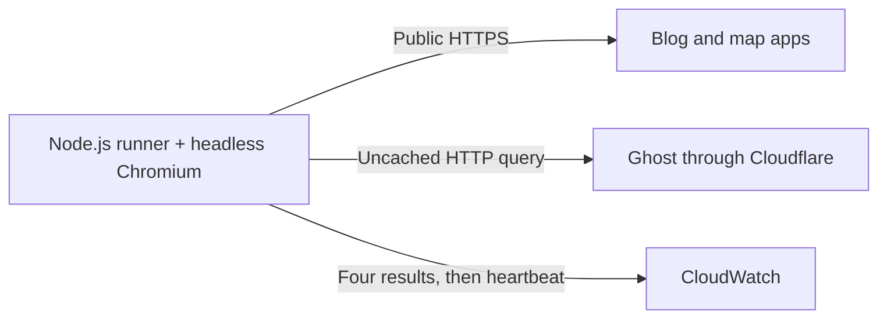

# Website monitoring

[System architecture](../README.md#system-design) · [Working spec](../specs/website-monitor.html)

Owns browser checks of the blog and both map apps, plus an uncached Ghost HTTP
probe. Product code owns its readiness state. The runner uses one Chromium process
and three isolated contexts concurrently; a page failure cannot cancel its peers.



## Build and check

From the repository root:

```sh
npm ci --prefix monitoring
node monitoring/node_modules/playwright-core/cli.js install chromium
npm test --prefix monitoring
LOCAL_BROWSER=1 npm run probe --prefix monitoring
docker build --platform linux/amd64 --provenance=false -t website-monitor:dev monitoring
docker run --rm --platform linux/amd64 -e AWS_EXECUTION_ENV=AWS_Lambda_nodejs22.x --entrypoint node website-monitor:dev dist/src/probe.js
```

The probe reads production but publishes no metrics or emails. Tests use a local
fixture server and real headless Chromium; no production data is needed.
Playwright and the Lambda Chromium package are pinned to Chromium 153.
WebGL stays enabled through SwiftShader. Browser contexts retain web security.

The production handler requires `METRIC_NAMESPACE` and an event containing
`scheduledTime`, an ISO timestamp supplied by EventBridge Scheduler. Work older
than two minutes is rejected. Results use that timestamp so retries do not create
extra evaluation periods. A completed heartbeat is published only after all four
result metrics succeed. Browser startup or metric publication failure produces
no heartbeat.

## Success and diagnostics

The blog must show its footer site identity and an article title. Map pages must expose
`data-load-state="ready"`, a visible Mapbox canvas and interval slider. Required
scripts, CSS and initial data failures and uncaught exceptions fail the check.
CNEC calendar manifest 403/404 responses are expected for unpublished days;
a missing selected day still fails readiness. Later interval prefetch, optional resources and other console errors are diagnostics.
The pinned Plotly implementation waits for Mapbox `loaded()` before reporting
figure completion; readiness does not assert pixel correctness or data freshness.

Each page has a 45-second deadline, including a three-second post-readiness window.
The Ghost probe has ten seconds and requires HTML site content, the retained
`uptime=1` query and Cloudflare `DYNAMIC` or `BYPASS`. See the
[cache policy](../121gigawatts/hosting/README.md#public-page-caching).
Cloudflare analytics and the blog’s observed Google/Fathom loaders are blocked
before navigation; intentional aborts do not fail a page.

Results contain the URL, elapsed time and bounded text diagnostics. No screenshots,
traces, video, credentials or custom incident database are collected.
