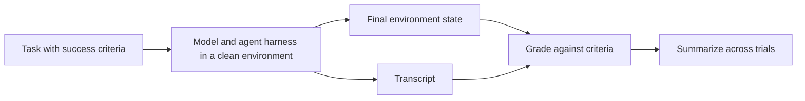

# Demystifying evals for AI agents

Mikaela Grace, Jeremy Hadfield, Rodrigo Olivares and Jiri De Jonghe, Anthropic Engineering, 2026-01-09. [Original article](https://www.anthropic.com/research/demystifying-evals-for-ai-agents)

An evaluation harness tests a particular model and agent harness together. Each trial starts with clean state. The transcript shows the steps and claims, while the outcome is the final state a grader can inspect. For Copper Sushi, a loading page or HTTP 200 alone leaves the requested content unverified. [Evaluation structure](https://www.anthropic.com/research/demystifying-evals-for-ai-agents#:~:text=The%20structure%20of%20an%20evaluation) · [Browser verification evidence](../rule-provenance.md)

- Seed tasks from manual checks and real failures. Use a known passing solution and cover when a behavior should fire and when it should stay idle. Prefer deterministic checks for verifiable outcomes and human-calibrated model graders for subjective qualities. Allow valid routes to the outcome. Read failed transcripts to distinguish agent mistakes, grader errors and environment problems. [Evaluation roadmap](https://www.anthropic.com/research/demystifying-evals-for-ai-agents#:~:text=Going%20from%20zero%20to%20one)
- Capability suites track unresolved challenges. Regression suites protect reliable behavior. `pass@k` estimates the chance of at least one success in `k` trials. `pass^k` estimates the chance all `k` trials succeed, which matters when each run must work. [Suite roles](https://www.anthropic.com/research/demystifying-evals-for-ai-agents#:~:text=Capability%20vs.%20regression%20evals) · [Repeat trials](https://www.anthropic.com/research/demystifying-evals-for-ai-agents#:~:text=How%20to%20think%20about%20non%2Ddeterminism%20in%20evaluations%20for%20agents)

The article draws on deployment experience. Its examples give no Copper Sushi baseline or measured effect for a specific rule. Automated suites complement live feedback and human review. The appendix surveys frameworks and allows simple scripts as a starting point. Copper Sushi's repeated-stumble bar applies to persistent instructions, a separate decision from whether to capture a failure as an eval case. [Evaluation limits](https://www.anthropic.com/research/demystifying-evals-for-ai-agents#:~:text=How%20evals%20fit%20with%20other%20methods) · [Framework appendix](https://www.anthropic.com/research/demystifying-evals-for-ai-agents#:~:text=Appendix%3A%20Eval%20frameworks) · [Agent harness engineering](../agent-harness-engineering.md)
