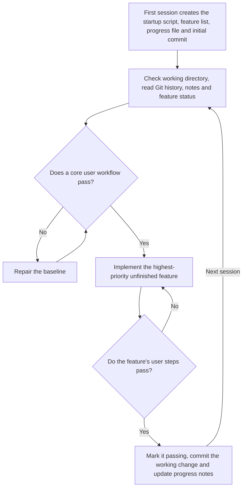

# Effective harnesses for long-running agents

Justin Young, Anthropic Engineering, 2025-11-26. [Original article](https://www.anthropic.com/research/effective-harnesses-for-long-running-agents). Used in [Agent harness engineering](../agent-harness-engineering.md).

In Anthropic's Claude Agent SDK demo, context compaction still left unfinished, undocumented work when the agent attempted too much. Later sessions could also mistake partial progress for completion. The first session used a different initial user prompt to set up the workspace. Later sessions shared its system prompt, tools and harness. [The long-running agent problem](https://www.anthropic.com/research/effective-harnesses-for-long-running-agents#the-long-running-agent-problem), [footnote 1](https://www.anthropic.com/research/effective-harnesses-for-long-running-agents#footnote-1).

The startup script runs the development server without rediscovering the setup each session. The sample startup transcript shows the agent reading the notes, feature list and Git history before testing the app. The baseline browser check opens a chat, sends a message and checks for a reply. Git provides a recovery point and the notes summarize progress for the next session. [Getting up to speed](https://www.anthropic.com/research/effective-harnesses-for-long-running-agents#getting-up-to-speed), [incremental progress](https://www.anthropic.com/research/effective-harnesses-for-long-running-agents#incremental-progress).

## Evidence and limits

- The chat demo starts with over 200 feature entries marked failing. The example checks that a new chat shows the welcome state and appears in the sidebar. The prompt restricts edits to pass status. Anthropic observed fewer unwanted edits to JSON than Markdown in this setup. [Feature list](https://www.anthropic.com/research/effective-harnesses-for-long-running-agents#feature-list).
- Unit tests and HTTP checks sometimes missed broken user workflows. Anthropic reports that explicit browser testing found bugs the agent had missed. Puppeteer could not show native browser alerts to the agent, and flows that relied on them remained more error-prone. [Testing and demo screenshots](https://www.anthropic.com/research/effective-harnesses-for-long-running-agents#testing).
- The article gives qualitative observations from full-stack app development. It contains no success rates or controlled estimates for individual changes. It leaves transfer to other domains and the value of specialized agents open. [Future work](https://www.anthropic.com/research/effective-harnesses-for-long-running-agents#future-work).

## Copper Sushi

The handoff pattern fits the repo's multi-session spec as working memory, with Git as the record of code changes and the wiki as the home for lasting findings. Browser checks supply evidence for the requested behavior before a feature is called complete. Copper Sushi groups settled changes into cohesive commits, so a session boundary alone does not determine when to commit. [Agent workflow design](../agent-workflow-design.md), [repository guidelines](../../AGENTS.md).
