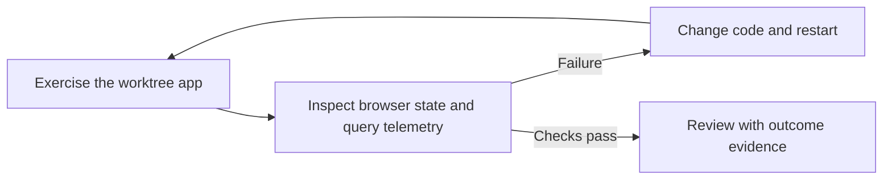

# OpenAI harness engineering

Ryan Lopopolo, OpenAI, 2026-02-11. [Original case report](https://openai.com/index/harness-engineering/). Used in [Agent harness engineering](../agent-harness-engineering.md).

## Evidence

- **Scope.** An internal beta built from an empty repository reached roughly one million lines and 1,500 merged pull requests in five months. Codex authored the code. Engineers set priorities and acceptance criteria and validated outcomes. [Experiment](https://openai.com/index/harness-engineering/#we-started-with-an-empty-git-repository), [human role](https://openai.com/index/harness-engineering/#what-agent-generated-actually-means).
- **Repository knowledge.** A short `AGENTS.md` pointed to indexed design records, versioned execution plans, and architecture and quality documentation. Continuous integration checked the structure and links. A recurring agent checked docs against code. The knowledge figure illustrates how team decisions become discoverable when recorded in repository Markdown. [Knowledge store and directory tree](https://openai.com/index/harness-engineering/#we-made-repository-knowledge-the-system-of-record), [knowledge figure](https://openai.com/index/harness-engineering/#agent-legibility-is-the-goal).
- **Executable constraints.** Custom lints and structural tests enforced dependency directions and selected reliability and style rules. Lint errors explained how to fix violations. The team required parsing at data boundaries and left the choice of parser open. The architecture figure shows restricted edges within a domain and a Providers interface for shared concerns. [Architecture and figure](https://openai.com/index/harness-engineering/#enforcing-architecture-and-taste).
- **Runtime feedback.** Each worktree could run its own app and disposable telemetry stack. The browser figure brackets an interaction with snapshots and captures runtime events. The telemetry figure routes logs, metrics, and traces through Vector to queryable services. [Browser and observability figures](https://openai.com/index/harness-engineering/#increasing-application-legibility).

The team also moved from weekly manual cleanup to recurring, narrowly scoped refactors. [Maintenance](https://openai.com/index/harness-engineering/#entropy-and-garbage-collection).

## Limits and project relevance

OpenAI's tenfold speedup is the team's estimate against hypothetical manual development. The case covers one new product through internal adoption. It leaves long-term architectural coherence open and ties end-to-end agent merges to that repository's tooling and merge policy. [Autonomy](https://openai.com/index/harness-engineering/#increasing-levels-of-autonomy), [merge policy](https://openai.com/index/harness-engineering/#throughput-changes-the-merge-philosophy), [open questions](https://openai.com/index/harness-engineering/#what-were-still-learning).

Copper Sushi already separates durable wiki knowledge from task specs. Its repository rules require rendered browser evidence, typed input boundaries, and approval before direct pushes to `main`. The case supports making verification and failure evidence available to agents within those rules. [Workflow design](../agent-workflow-design.md), [repository rules](../../AGENTS.md).
