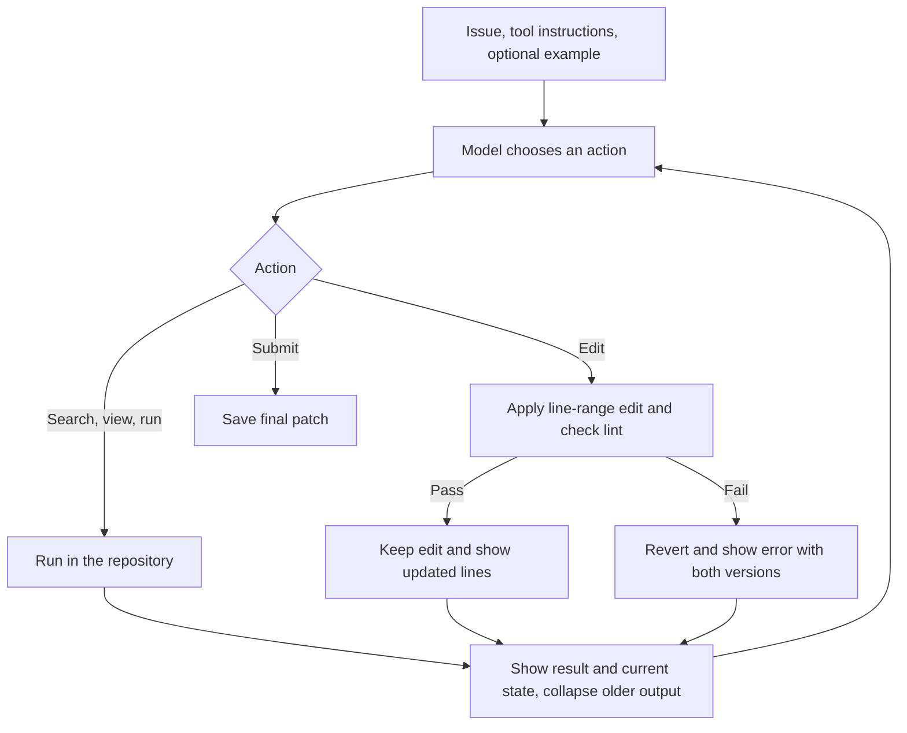

# SWE-agent

John Yang and colleagues, Princeton University, NeurIPS 2024. [Paper, arXiv v3, 2024-11-11](https://arxiv.org/abs/2405.15793v3). Used in [Agent harness engineering](../agent-harness-engineering.md).

## Interface

The agent-computer interface governs what the model can do, what each command reports, and which observations go back into context. SWE-agent adds targeted tools over a Linux shell in a disposable container. It keeps the sequence of actions and the last five full observations in the model's context. Older outputs become one-line placeholders. The saved trajectory retains the full interaction alongside the final patch. [§§2–3](https://arxiv.org/html/2405.15793v3#S2), [Appendix A.2](https://arxiv.org/html/2405.15793v3#A1.SS2), [Appendix C](https://arxiv.org/html/2405.15793v3#A3).

The loop shows the normal path. Budget exhaustion can also submit the edits already made. [Figure 9](https://arxiv.org/html/2405.15793v3#A1.F9), [Appendix B.9](https://arxiv.org/html/2405.15793v3#A2.SS9).

## Evidence

With GPT-4 Turbo, SWE-agent resolved **18.0%** of 300 SWE-bench Lite tasks, versus **11.0%** for the shell-only agent with a demonstration and **7.33%** without one. The paper's 10.7-point headline uses the latter baseline. On the full 2,294-task benchmark, SWE-agent resolved **12.47%** with GPT-4 Turbo and **10.46%** with Claude 3 Opus. The shell-only comparisons used Lite. [Table 1 and §5](https://arxiv.org/html/2405.15793v3#S4).

Changing one part of the 18.0% Lite configuration at a time produced these results. [Table 3](https://arxiv.org/html/2405.15793v3#S4.T3).

| Interface change | Tasks resolved |
| --- | ---: |
| Turn off linting, keep the line-range editor | 15.0% |
| Remove the editor | 10.3% |
| Show search matches one at a time | 12.0% |
| Remove dedicated search tools | 15.7% |
| Show 30 lines or the entire file instead of 100 lines | 14.3% or 12.7% |
| Keep full observation history in context | 15.0% |
| Remove the demonstration | 16.3% |

The authors designed the tools by inspecting recurring failures on development tasks. The search guardrail asks the agent to narrow broad queries. The editor reports the lint error, the rejected edit and the restored source together. The lint check assumes a clean starting file and can require related changes to land together or in a specific order. [§§4–5.1](https://arxiv.org/html/2405.15793v3#S4), [Appendix A.1](https://arxiv.org/html/2405.15793v3#A1.SS1).

## Limits

- Repeated failed edits were associated with lower recovery. The chance that a sequence of edit attempts eventually produced a valid edit fell from 90.5% before a failure to 57.2% after one. The paper measured that pattern without testing a rule that stops or restarts those runs. [Appendix B.3.3](https://arxiv.org/html/2405.15793v3#A2.SS3.SSS3).
- Passing the benchmark can miss maintainability and behavior differences. The Requests patch duplicated a utility. The Pylint patch passed with a broader match than the maintainer's fix. The SymPy attempt exhausted its budget while scrolling, and the Django attempt submitted an untested change at the wrong interface. [Appendix D](https://arxiv.org/html/2405.15793v3#A4).
- Six GPT-4 Turbo runs resolved 17.33–18.67% each, and 32.67% of issues were solved at least once. The 100-line view and five-observation history came from a sweep on 37 development issues. The paper leaves transfer to other domains open. [Appendix B.1](https://arxiv.org/html/2405.15793v3#A2.SS1), [Appendix B.5](https://arxiv.org/html/2405.15793v3#A2.SS5), [Appendix E.3](https://arxiv.org/html/2405.15793v3#A5.SS3).
