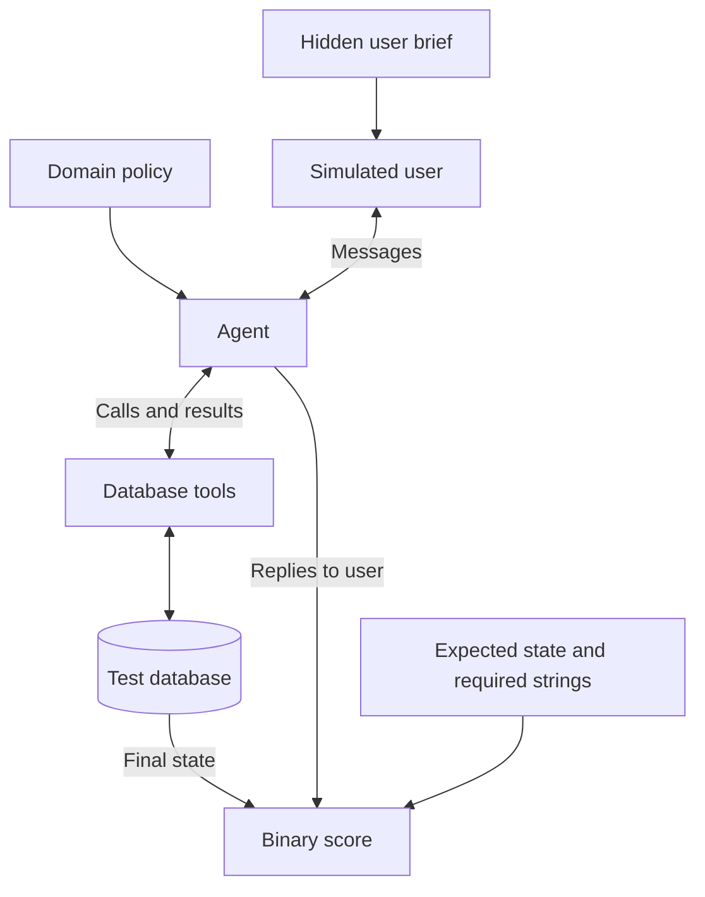

# τ-bench

Shunyu Yao, Noah Shinn, Pedram Razavi and Karthik Narasimhan, Sierra, 2024-06-17.
[*τ-bench: A Benchmark for Tool-Agent-User Interaction in Real-World Domains*, arXiv v1](https://arxiv.org/abs/2406.12045v1).
Evidence for [agent harness engineering](../agent-harness-engineering.md).

## How a trial works

Each task starts from a fixed database and a hidden user brief with one intended outcome. The simulated user can reveal information over multiple turns. Tool operations are deterministic. At the end, the scorer compares the full database with the expected state and checks that the agent's messages contain any required strings. [§3 and Figure 2](https://arxiv.org/html/2406.12045v1#S3)

### Pass-k

`pass^k` averages each task's probability of passing **all** `k` independent trials with the same brief and starting state. `pass@k` measures the chance that **at least one** trial passes. With function calling, GPT-4o scored 61.2% on retail and 35.2% on airline for one trial. Retail dropped below 25% for eight consecutive successes. [§3](https://arxiv.org/html/2406.12045v1#S3), [Table 2](https://arxiv.org/html/2406.12045v1#S5.T2), [Figure 4](https://arxiv.org/html/2406.12045v1#S5.F4)

## Evidence for harness design

- **Test the outcome and the required steps.** A return can pass the final-state check even if the agent skipped required confirmation. The retail tool rejects a second exchange after the first changes the order status. A partial first exchange can therefore block a valid second request. [§3](https://arxiv.org/html/2406.12045v1#S3), [Appendices B.1](https://arxiv.org/html/2406.12045v1#A2.SS1) and [C.2.1](https://arxiv.org/html/2406.12045v1#A3.SS2.SSS1)
- **Check whether policy text earns its place.** Removing it reduced GPT-4o's score by 4.4 percentage points in retail and 22.4 in airline, using the ablation's own baselines. This measures the effect of the policy prompt in these tasks. It leaves the impact of enforcing those rules in code open. [Table 3](https://arxiv.org/html/2406.12045v1#S5.T3)
- **The tool interface affected scores.** Native function calling beat both text-formatted variants in the retail comparison across the four GPT models tested. [Figure 3](https://arxiv.org/html/2406.12045v1#S5.F3)
- **Tool success can mask a wrong result.** The exchange API accepted an available lamp of the same brightness after the user had asked for a dimmer one. The user confirmed the agent's suggestion. In a separate case, the simulator narrowed an all-orders request to one order, while the grader still expected all address corrections. [Appendices C.2.2](https://arxiv.org/html/2406.12045v1#A3.SS2.SSS2) and [C.2.3](https://arxiv.org/html/2406.12045v1#A3.SS2.SSS3)

The figures describe two synthetic customer-service domains. The authors used GPT-4 Turbo trials to refine task prompts and inspected tasks with low or zero success for annotation defects. The rates depend on the curated tasks and simulated user. Open-ended repository work can have several valid end states, which calls for behavioral checks that accept each valid result. [§4](https://arxiv.org/html/2406.12045v1#S4), [§6](https://arxiv.org/html/2406.12045v1#S6), [Appendix A](https://arxiv.org/html/2406.12045v1#A1)
